# Website

Write and organize notes, keep reference files, collaborate, and manage recurring work in Notegic.

## Beginning

### Demonstration

Dashboard provides widgets, the Sidebar organizes notes and files, and Routines manages automated work. The examples below use a research project.

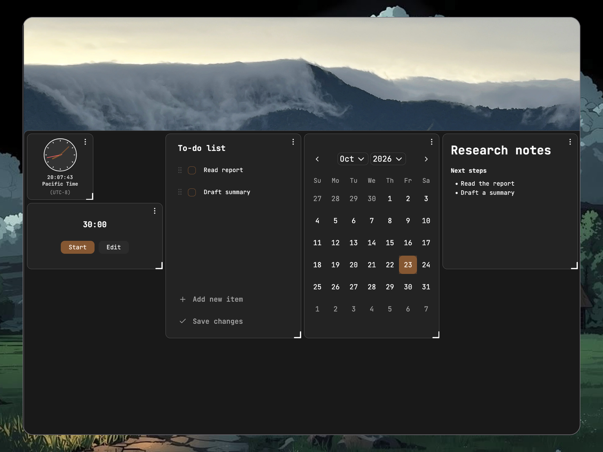

Image 01 — Dashboard overview

This is a customized example layout. See [Widgets](#widgets) to add and arrange your own tools.

[Watch on YouTube: Workspace Overview](https://youtu.be/pH21Od0Io58)

Video 01 — Workspace Overview

### Big picture

#### What can this app do?

Organize separate projects and place documents and reference files in suitable categories. Documents can contain headings, lists, tables, code, formulas, and diagrams alongside ordinary text. These individual units are called Blocks; together, they form a document called a Block Pack.

Collaborate on documents in a Root Shelf you have permission to access. For recurring work, create a Routine in a Station and add individual Routine Tasks. The website separates configuration from execution records so you can check both what you configured and what actually happened.

#### Why this app?

When information is scattered across files, notes, and tools, it can be difficult to trace a source or return to unfinished work. In Notegic, begin by giving each piece of content a clear location and purpose, then add the workflow you need.

For example, keep an original research PDF as a Material and write your observations and summary in a Block Pack. They are related but serve different purposes: one preserves the reference source, while the other is a document you continue to revise.

This structure supports learning notes, research materials, project documentation, and team knowledge that accumulate over time.

#### How can we get started?

Use a small project for your first session:

1. Sign in and enter your workspace through Dashboard or the Sidebar.
2. In the Sidebar's Root Shelves area, select the add button and create a Root Shelf named Research Project.
3. Open that Root Shelf's actions menu and add a Sub Shelf, such as Topic Notes.
4. Open the Sub Shelf's actions menu, choose Block pack from the Items submenu, and name the new document Research Summary.
5. Open the document and add a heading, a short summary, and a list of questions to investigate.
6. Navigate elsewhere through the Sidebar, then return to the same Block Pack to confirm that you can find it again.
7. Before leaving, check for loading, synchronization errors, or pending changes.

On desktop, item actions are usually available from the right-click menu. If an expected action is missing, check whether you selected a Root Shelf, Sub Shelf, or document, and whether your account has the required permission.

[Watch on YouTube: Create and Organize Your First Note](https://youtu.be/s05mQsBdZ9Q)

Video 02 — Create and Organize Your First Note

### Future development

The following are planned directions, rather than currently available features or commitments to specific release dates. See [Versions](/document#versions) for published changes and recent plans.

#### AI & RAG in routine tasks

We want automated work to make better use of existing notes and reference content, reducing the need to enter the same context repeatedly. Future AI and retrieval features will be guided by practical information-management and workflow needs.

#### MCP and tool calling

We are exploring ways to connect conversations with tool actions more naturally. Alongside producing answers, the aim is to help people understand the proposed actions and the content they may affect.

#### Chat AI and note assist AI

Future conversation interfaces will work more closely with Notegic's note structure, making it easier to turn conversation results into formatted, editable content.

#### More components for learning and researching

We are exploring additional content types for learning and research.

### Currently working on

Our current focus is AI integration and conversation interfaces that work with Notegic's note structure. We also continue to improve consistency, documentation, and scheduling across existing features.

---

## Component

### Structured storage

Storage organizes content hierarchically, with separate roles for categories, editable documents, and reference files. A simple research project might look like this:

```text
Research Project (Root Shelf)
└─ Topic Notes (Sub Shelf)
   ├─ Research Summary (Block Pack)
   │  └─ Headings, paragraphs, lists, and other Blocks
   └─ Reference Report (Material)
```

This example illustrates how the content types work together. Available creation and movement options depend on the current menu.

#### Root Shelf

A Root Shelf is the outermost category for a project or collection. It can contain Sub Shelves for organizing notes and reference files. Access to the collection is managed through its Root Shelf.

For example, keep personal research and team projects in separate Root Shelves. Names that describe their purpose are easier to recognize than names such as Folder 1.

To create one, select the add button beside Shelves in the Sidebar, enter a name, and confirm. You can then expand it or open its actions menu to add categories, rename it, or use management actions you have permission to perform.

Delete, leave, and transfer ownership are separate actions. Deleting affects the resource, leaving removes your membership, and transferring ownership changes who manages it. Read the resource name and scope in the confirmation before proceeding.

#### Sub Shelf

A Sub Shelf is a category within a project and can contain further levels. Organize by topic, such as Methods, Cases, and References, or by stage, such as To Read, In Progress, and Completed. Add categories when you need them rather than creating an empty hierarchy in advance.

Add the first Sub Shelf from the Root Shelf's actions menu. From a Sub Shelf's menu, add another Sub Shelf, a Block Pack, or a Material. An extra category does not create an independent set of permissions; check the owning Root Shelf when sharing with others.

After moving an item, check the Sidebar and item path to confirm its location. If something seems missing, check for collapsed categories before creating another copy.

#### Block Pack

A Block Pack is a document you write in Notegic. Open it to enter text, arrange paragraphs, and add other Block types. Use it for research summaries, meeting notes, project descriptions, or notes you expect to revise.

Give each Block Pack a clear name so you can recognize it in the Sidebar and item path. Reading width and font size are display preferences, separate from the document's content.

Before collaborating, confirm that the other person has access to the owning Root Shelf. Sending a document URL does not grant permission.

#### Material

A Material holds a reference file, such as a PDF report, image, audio file, or video. Use Material to retain and view a source file, and Block Pack to write and revise your own content.

Keep the original research report in a Material and summarize its key points in a Block Pack. This preserves the distinction between the source and your observations and makes it easier to return to the original.

Preview availability depends on the file type, content, and browser support. Uploading or opening a file does not automatically turn it into an editable document or run AI analysis.

#### Block

A Block is a unit of document content. Paragraphs, headings, tables, and other types each support editing and arrangement suited to their content.

Start with a small structure: a heading, a summary paragraph, and a list of next steps are usually easier to maintain than many different Block types added at once.

### Automation

Automation arranges what to do, when to do it, and which steps must come first. The website separates two kinds of information:

- Definitions: the workflow, tasks, and dependencies you configure.
- Records: what happened during an execution and its final status.

Changing a definition does not mean it has run successfully, and a schedule alone does not confirm that a result exists.

#### Station

A Station groups related automated work. For example, use one Station for research preparation and another for project maintenance. Choose the appropriate Station before adding work so you can find and manage it later.

Station permissions are managed separately from Root Shelf permissions. Being able to read a note does not give someone permission to manage every related automated workflow.

#### Routine

A Routine defines a workflow, including its name, description, schedule, and tasks. Weekly Research Review might be a Routine; whether it ran successfully this week belongs to a separate execution record. Editing a Routine changes its configuration for subsequent work, rather than rewriting past results.

Choose a name that explains its purpose and add a description where useful. When scheduling, check the recurrence, start and end conditions, and displayed timezone. Review these settings again if you change the time.

Creating a Routine does not mean its tasks have completed. Check the execution records for actual results.

#### Routine Task

A Routine Task is an individual action within a Routine. Each task has a purpose and the required inputs, with priority and attempt settings where provided.

Decide which resource the task should act on and what it should do, then select the purpose and enter the inputs. Use a descriptive name, such as Create This Week's Summary, rather than Task 1.

Use non-critical test content when configuring a task for the first time. Confirm the affected resources before testing update or deletion actions in an important project.

#### Routine Task dependencies

Dependencies specify which step must wait for another. If B uses content created by A, arrange A first and make B depend on it. The graph represents this with a connection from A to B.

Connect tasks within the same Routine only where a real ordering requirement exists, and avoid cycles. Check both the connections and the saving state: an unsynchronized or invalid change is not a confirmed execution condition.

If a prerequisite fails or does not run, inspect the records and statuses. An arrow alone does not guarantee that a later task will execute.

#### Routine Tag

Routine Tags categorize Routines so you can view related work together. A tag is not a task; creating or applying one does not execute work.

Use tags for purposes or work areas such as Research Preparation, Weekly Review, or Project Maintenance. When filtering, remember that untagged Routines may be hidden too.

### Future (not implemented)

Learning Card and Exam are content types still being explored and are not currently available operations in this guide.

Learning Cards aim to support repeated practice with information, while Exams are a possible way to assess learning. Their fields, operation, and release scope are not finalized. You do not need to prepare data or change existing notes for them.

---

## User Interface

### Dashboard

Dashboard is your working home page. Add clocks, timers, tasks, and notes to see useful information when you open the website. These tools do not change document organization in the Sidebar. Use Shelves for notes and Routines for automation.

#### Header background image

In Dashboard layout editing mode, the header displays an option to change the background. Choose an image, adjust its crop and position, and check the preview before confirming. Changing this background does not require changes to notes or Station settings.

Dashboard backgrounds and personal layouts belong to the current browser. Do not expect them to appear automatically in another browser or device; clearing website data may remove them.

#### Widgets

A Widget is a small tool on Dashboard. Choose a built-in tool and adjust its position and size without writing code. Each tool has different controls; the sections below explain its purpose and how to add, edit, and save it.

##### Defaults

Defaults refers to tools already available to add, rather than tools that all appear automatically on first use. The picker groups basic tools and guidance content so you can choose what you need.

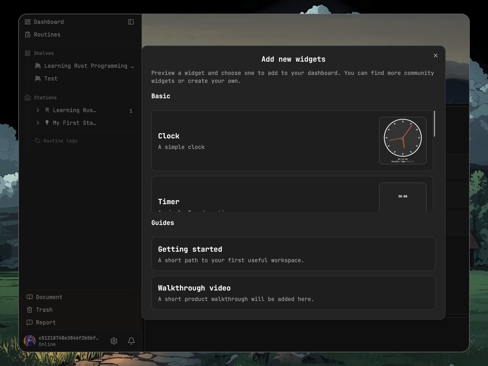

Image 02 — Widget picker

Previews help you recognize tools; they are not interactive versions of the widgets. Select an item to add it to Dashboard. You can add more later without arranging the entire page at once.

###### Clock

Place a clock where you need to check the time, including the time in another region. After adding it, check its timezone, which may differ from your location.

Open Edit from the Widget menu to adjust:

- Timezone: the region displayed by this clock. It does not change a Routine's scheduling timezone.
- Clock style: an appearance such as traditional, minimal, or modern.
- Digital time: whether to show hours, minutes, and seconds alongside the clock face.
- Region name: whether to show the selected region and timezone.
- Text size: separate sizes for the digital time and region information.

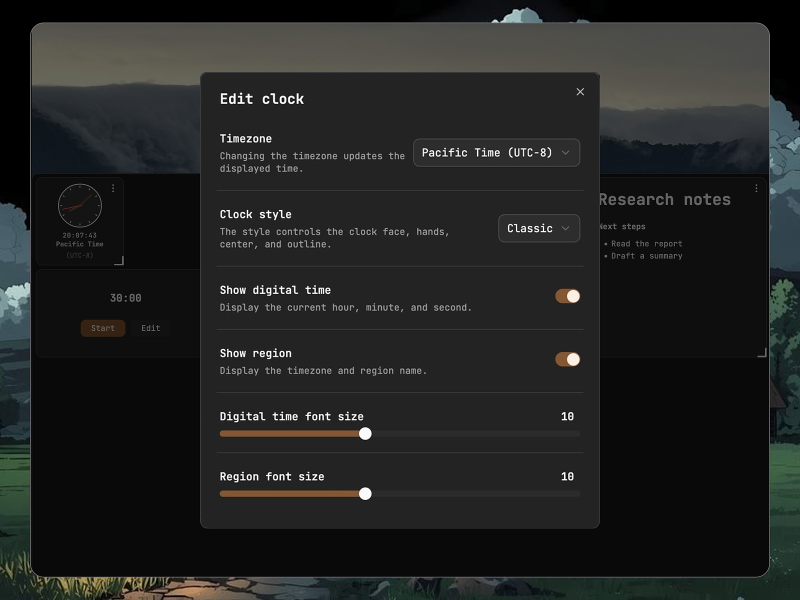

Image 03 — Clock settings

If the time differs from what you expect, check the timezone before changing your computer's clock. If labels are crowded, increase the Widget's size or reduce its text size.

###### Timer

Use the timer to count down a work session, such as thirty minutes of reading before organizing notes. Starting it does not create a Routine or automatically carry out a task.

The main controls are:

1. Before starting, select Edit to adjust hours, minutes, and seconds. Select Save to keep the duration or Cancel to discard the change.
2. Select Start to begin the countdown.
3. Select Pause to stop temporarily, then Resume to continue.
4. Select Reset to return to the configured starting duration, rather than the time remaining when you paused.

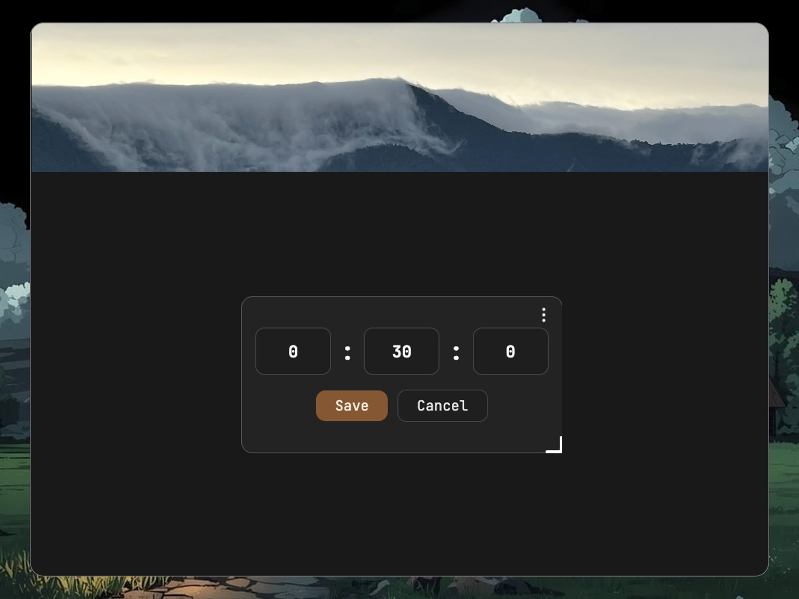

Image 04 — Timer duration

Edit within the timer changes its duration. Edit in the Widget menu changes its appearance, such as the size of the countdown and controls. The quiet-mode setting hides controls; it is not a guarantee about audible alerts.

If controls are missing, check quiet mode in the Widget settings. Do not rely on the timer as a background alarm: closing the page, reloading, or browser restrictions on background activity may interrupt it or prevent a reminder.

###### To-do list

Use a to-do list for a few things you want to complete today. It does not create automated tasks, and checking an item does not trigger a Routine.

To begin:

1. Select the list title and give it a recognizable name, such as This Week's Research.
2. Select Add new item and enter the task.
3. Drag the handle on the left of a row to change its position.
4. Check an item's box when finished; its text changes to the completed style.
5. Select Save changes within the list to save edits. Text appearing on screen does not by itself confirm that it has been saved.

Hover over a row to reveal actions such as adding a link or removing the item. Links can point to reading sources or related pages. Check unfamiliar external URLs before opening them.

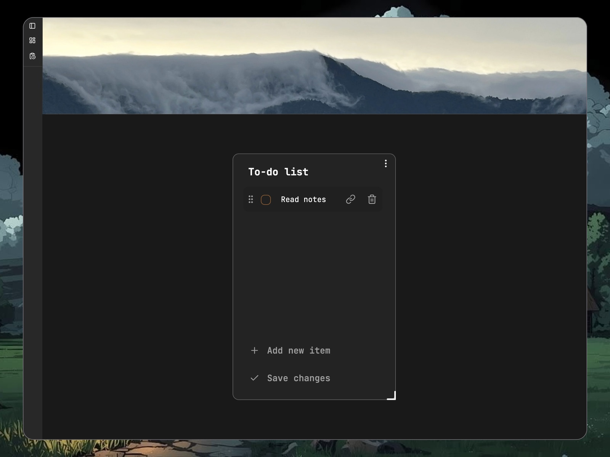

Image 05 — To-do list controls

The example is still being edited, so Save changes is visible. Use that button after completing your changes.

Widget appearance settings adjust the title font, item font, and row height. For longer content, increase the Widget size or adjust its text size rather than deleting useful text to make it fit.

###### Calendar

Use Calendar to check dates or select a date while planning. Change the month and year with the menus or arrows, then select the date you need.

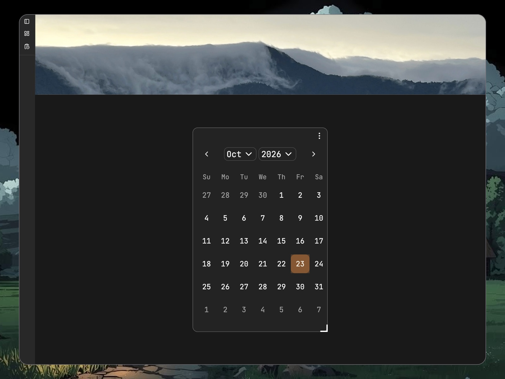

Image 06 — Calendar navigation

This Widget is not currently an event manager. Selecting a date does not create an event, modify a Routine, or add a reminder. Configure a Routine's schedule to set execution times.

Calendar does not have the same dedicated appearance panel as Clock, but you can move it and adjust supported sizes in Dashboard layout editing mode.

###### Scratch Pad

Scratch Pad is a Dashboard note for brief ideas, next steps, and reminders. Select its content to edit; leaving the text area returns it to reading mode.

It supports Markdown for basic formatting such as headings, lists, and bold text. For example, enter `# Research Notes` as a heading and start lines with `-` to list work to organize. Editing shows the source syntax; reading mode displays the formatted result.

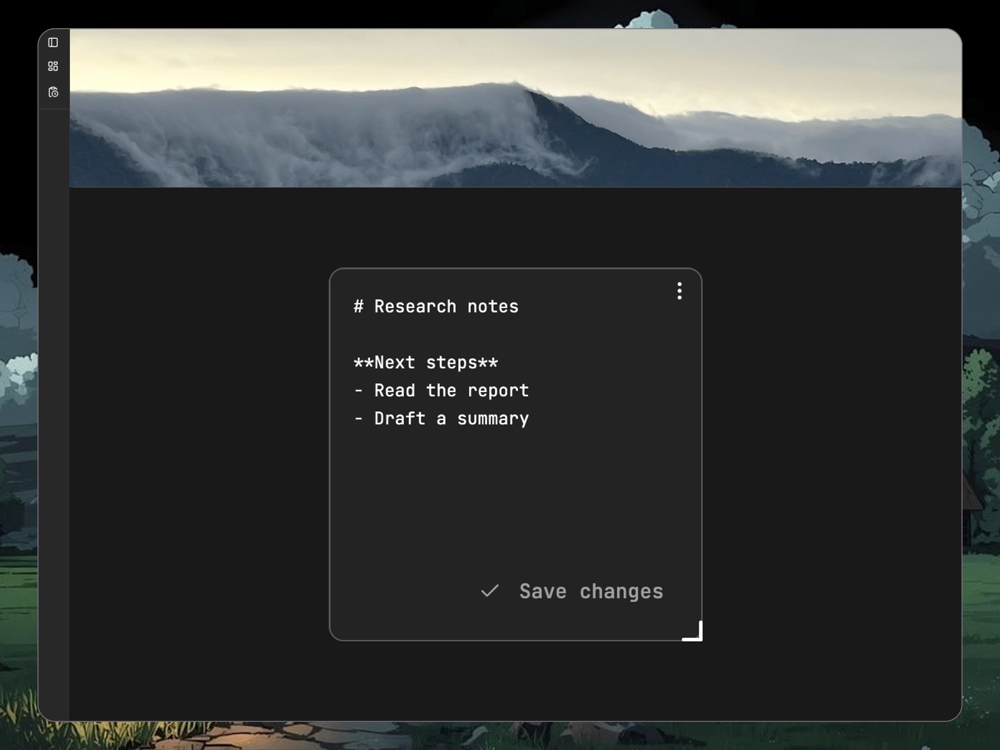

Image 07 — Scratch Pad editing

Select Save changes within the note after editing. Returning to preview by clicking elsewhere is separate from saving. Appearance settings can adjust text size to suit the Widget's dimensions.

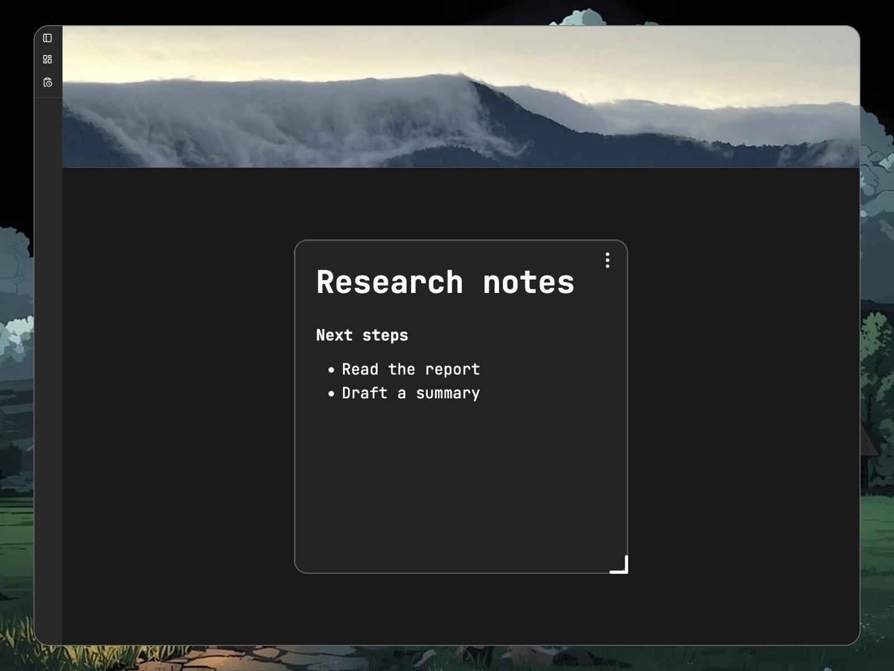

Image 08 — Scratch Pad preview

Scratch Pad content stays in the current browser and is not a document for team collaboration. Move content that needs long-term storage, sharing, or fuller organization into a Block Pack.

###### Getting started

This is a paginated checklist for getting started. Expand each item to read the instructions and check it when you finish. The count below shows progress on the current page, and the arrows switch pages.

Checking an item records your own progress; it does not create data for you. After checking Create a Category, you still need to create it in the Sidebar. If you have already completed an action, you can return and check it afterward.

You can complete the first page and continue with your own work. The checklist does not require you to learn every automation feature at once.

###### Walkthrough video

Watch Workspace Overview directly in this Widget for a tour of notes, reference files, and routines. Select play to load the video; use the player controls to pause, seek, or enter full screen. You can also [watch Workspace Overview on YouTube](https://youtu.be/pH21Od0Io58).

Getting started and Walkthrough video are guidance content and may span the workspace width, unlike smaller clocks. Neither currently has the standard Widget appearance panel.

##### Usage

Distinguish three kinds of Widget changes: moving the tool on the page, changing its appearance, and editing its content. They have different controls and may use different save buttons.

###### Add a widget

Select the pencil icon at the bottom right of Dashboard to edit the layout. Add, width, and completion controls appear, along with controls around the Widgets.

Select the plus button at the bottom right to open the picker and add a tool. If an empty grid area with a plus sign appears, you can add one there too. New tools may be outside the current view, so scroll down if needed.

Add one or two tools first, then arrange the page gradually so it remains clear what you are changing.

###### Move and resize

In layout editing mode, drag tools to allowed positions and use their bottom-right handles to resize them. Widgets follow the grid and supported sizes; not every tool can take any width or height.

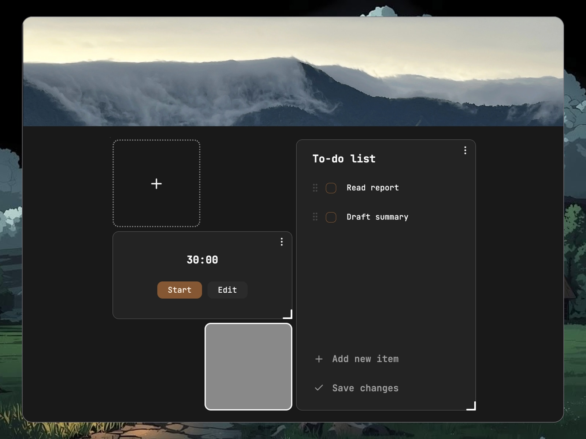

Image 09 — Widget drag destination

The example shows a drag before release. The pale area is a proposed destination, rather than a newly added Widget. Release the tool, confirm its position, then save the layout.

A limited set of sizes may be intentional. Clocks, calendars, and longer to-do lists support sizes suited to their content.

The narrow/wide control at the bottom right changes the available width of Dashboard, rather than a single Widget's font or size. Identify which level needs adjusting when the layout feels crowded.

###### Edit a widget

During layout editing, a Widget's three-dot menu shows its available actions. Tools with dedicated settings provide Edit; other tools may offer different options.

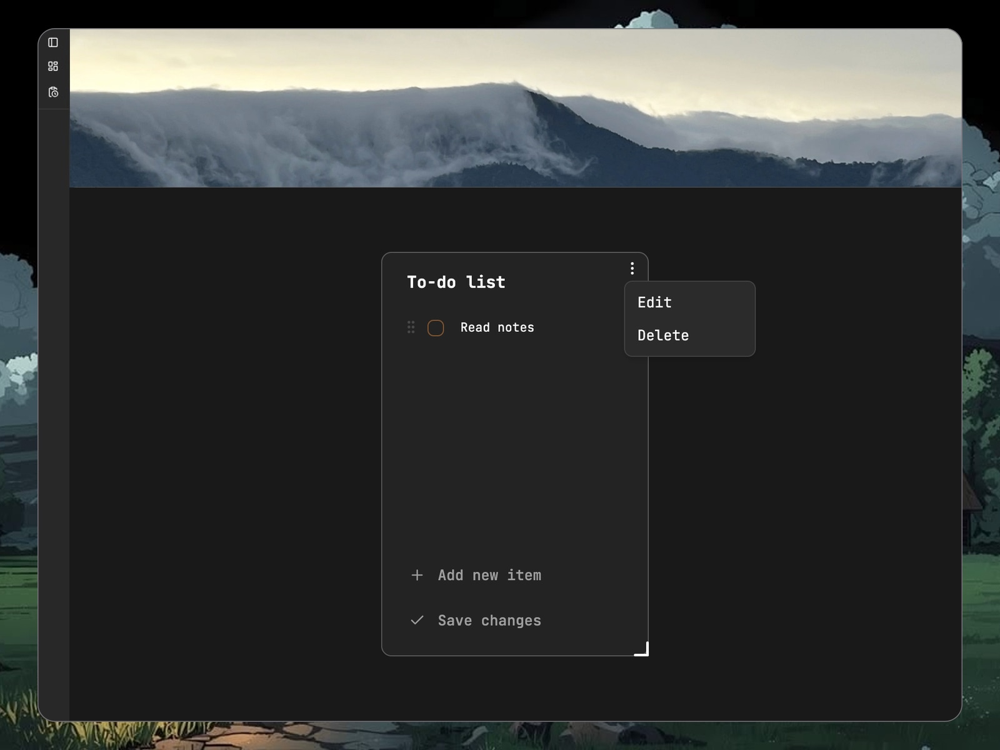

Image 10 — Widget actions menu

Use the settings described for each tool above. These are separate from changing the timer duration or typing into a to-do list. Close the appearance panel when finished, then complete and save Dashboard layout editing.

###### Save your changes

After arranging positions and sizes, select the checkmark at the bottom right of Dashboard to save the layout and leave editing mode. You can then use timers and enter content without accidentally dragging the whole tool.

To-do list and Scratch Pad also have their own Save changes controls. Save Dashboard after moving tools, and save the individual tool after editing its content.

This data is stored in the current browser. Do not expect the full Dashboard to follow you after clearing website data, changing browsers, or switching devices. Keep important documents in a location suited to long-term storage.

###### Remove a widget

Before removal, check for notes or tasks you want to keep. Delete in the Widget menu removes the whole tool, rather than closing settings or removing one task row.

Save anything you may still need elsewhere first. Do not assume that a removed Dashboard Widget can always be recovered from Trash.

##### Customized

This refers to possible future custom Widgets or other extensions and is not currently implemented. This guide does not provide steps for installing community components, uploading tools, or writing Widget code.

#### Other interactive UI components

Controls can act on a layout, a component's content, or an entire resource. Check their scope before using them: deleting a Widget and deleting a document have different effects.

Some controls are temporarily disabled while saving or loading. Wait for the result rather than submitting repeatedly because the page has not changed immediately.

On narrow screens, the Sidebar and some controls collapse. Open the Sidebar when you need to navigate. If the view is crowded, adjust density or text size in preferences.

### Sidebar

Use the Sidebar to find documents and switch pages. Dashboard and Routines are at the top, content categories and Stations are in the middle, and documentation, Trash, feedback, and account actions are below.

Collapse it on narrower screens or when you need more space for content, then reopen it to navigate. Collapsing the Sidebar does not delete data or remove you from a project.

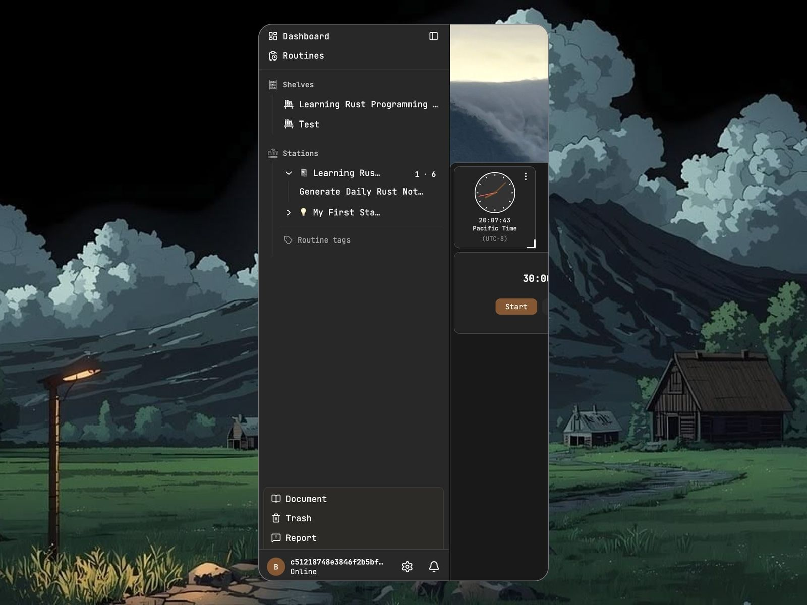

Image 11 — Sidebar overview

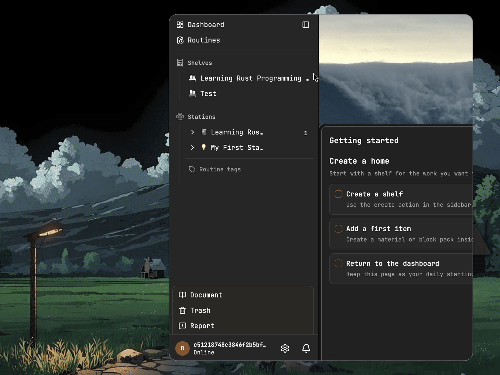

GIF 01 — Sidebar navigation

#### Structured storage area

Expand a Root Shelf and its Sub Shelves to find documents and reference files. Check for collapsed categories when an item is missing. If different projects contain documents with the same name, check the parent category before opening one.

On desktop, right-click an item to open its menu. Available options depend on the item:

- Root Shelf: add a Sub Shelf, rename the collection, or find membership and ownership actions.
- Sub Shelf: add another Sub Shelf; for documents and files, open the Items submenu and select Block pack or Material.
- Documents and files: open, rename, or use other actions your permissions allow.

If an option is missing, check where you right-clicked. A document and its parent category have different menus.

When renaming, finish and confirm the new name before moving the item or performing another action. You do not need to delete and recreate it; that would create a different resource.

#### Automation area

Stations is for finding automated work, rather than another folder group for notes. Expand a Station to view Routines, or use Routine Tags to organize work by purpose.

On the Routines page, you can choose which Stations to display. If work seems missing, check Station and tag filters before creating it again.

#### Document, Trash, and Report area

- Document: read website guides, API documentation, versions, and other public information.
- Trash: view listed deleted items and find resources by name or type.
- Report: open feedback to report a problem or suggest a feature.

Trash currently focuses on viewing and searching. A listed item does not guarantee that the website can restore it. Save important content before deleting it.

#### User information

The bottom of the Sidebar shows the signed-in account and connection information. If a project seems missing after switching accounts, check that you are using the intended identity.

Display names and avatars help identify people; they do not determine resource ownership. Changing your profile does not grant access to other projects.

#### Settings and logout

Open account settings for personal information, API keys, and security. Open preferences for themes, fonts, editor behavior, and notifications. Distinguish changes to the account itself from changes to how you view and use the website.

Depending on screen size and settings, these areas may open as a full page or side sheet. They are different presentations of the same account's settings.

Before signing out, check for saving or synchronization notices. Signing out does not force every pending change to upload and is not a backup of local content.

#### Notification

Select the notification control to open the list. The unread count indicates unseen messages. Open a message to read its details and use the available actions to update its read state.

Wait when the list is loading. An empty state means that no messages are listed; a failure means that the connection or request needs attention. If a message becomes unread again, its read state may not have saved. Check again rather than resetting the account.

In-app notifications, temporary feedback messages, and browser notifications are different. Browser notifications require permission, and permission alone does not guarantee that every message will arrive in the background.

### Block pack editor

#### Block-based editor introduction

Open a Block Pack from the Sidebar and wait for it to load before typing. Empty areas prompt you to type or use `/` to open the command menu. You can write first and organize later without deciding the entire document's formatting in advance.

Documents consist of Blocks. Each paragraph, heading, or table has its own content and actions, allowing you to move one part without cutting and pasting the whole document.

##### Insert a block

Type `/` at an editable position to view the available types. Select an item directly, or continue typing its name to narrow the list and choose with the keyboard or mouse.

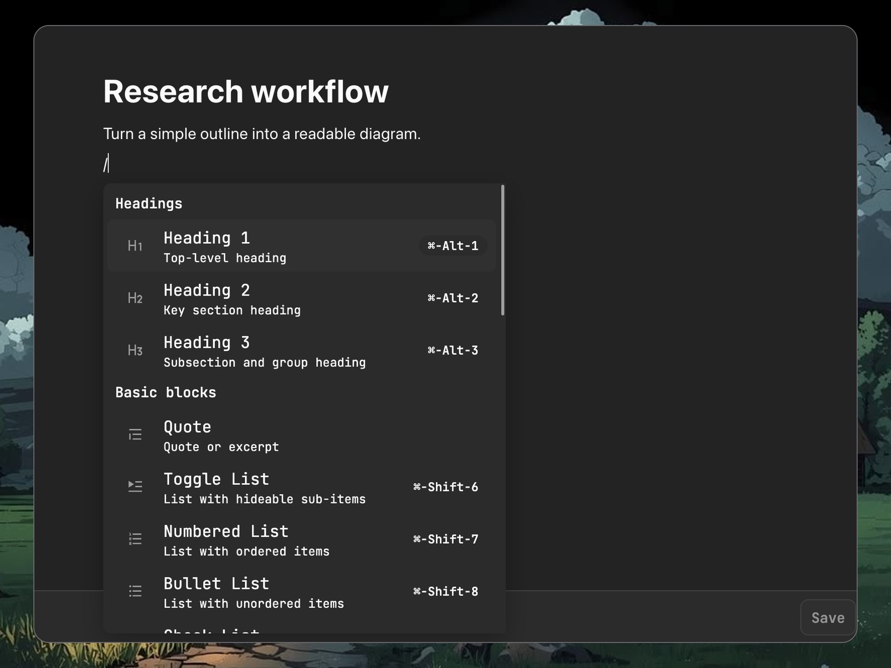

Image 12 — Block insertion menu

This image and the next two Diagram images use the task template editor to demonstrate Blocks. Templates and ordinary documents use the same block structure, although the standard Block Pack editor may provide additional menu items. Confirming template content and creating a task are separate steps, explained in the Payload editor section.

Lists, diagrams, and calendars in this menu are document Blocks, rather than Dashboard Widgets or automation settings. Inserting a calendar in a document does not create a Routine schedule.

##### Headings and lists

Use headings to divide sections and paragraphs to explain them. Begin with a main heading for the topic, then use smaller headings for questions, evidence, and conclusions. Heading levels define document structure as well as appearance.

Choose lists by purpose: bullets for points without a fixed order, numbered lists for sequences, and checklists for tracking completion. Collapsible lists or headings can hold longer supporting material without expanding everything into the main text.

##### Tables and code

Tables help compare sources, viewpoints, and questions to investigate. Decide what each column should answer before entering data, rather than filling cells with long passages.

Code blocks preserve precise formatting for snippets and commands. Code recorded in a document does not execute simply because it is displayed. Remove credentials or private information before sharing.

##### Math and diagrams

Formulas can appear in their own Blocks or within text. Use a separate formula for an expression that needs its own space, and inline formulas when explaining a symbol within a sentence.

Diagram renders Mermaid text as a diagram. This simple example contains Start and Stop nodes:

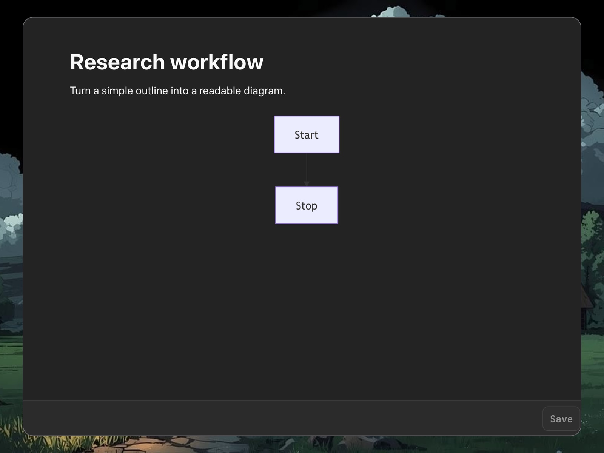

Image 13 — Diagram preview

Double-click the diagram to open its source editor, make changes, and select OK to finish. The example uses:

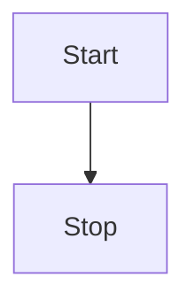

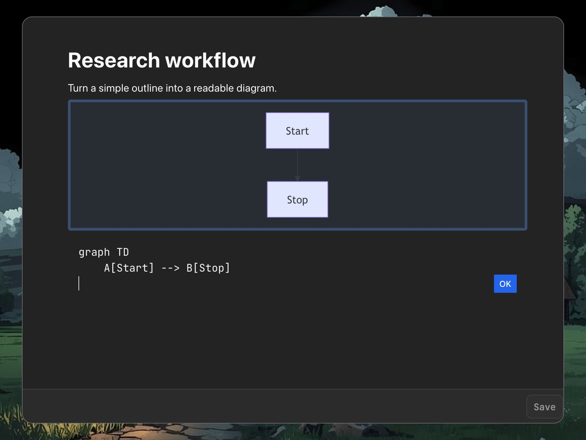

Image 14 — Diagram source editor

Document arrows illustrate ideas; they do not control Routines. Use the dependency graph editor described later to configure task ordering. Both views contain nodes and connections, but serve different purposes.

##### Images and other media

The insertion menu also provides images, video, audio, and files. These are document media Blocks. Follow the fields shown for each Block to provide a supported source.

If external media fails to load, check that the source remains accessible and that your account has permission. Do not use private signed URLs or temporary download links as permanent sources for public content.

##### Arrange your content

A research summary can begin with three parts:

1. A heading for the research topic.
2. Paragraphs describing your current understanding and key observations.
3. A list of questions to investigate and next steps.

Use a Block's drag handle to change its position. To edit text, select its content instead. If handles are missing, check the relevant editor preference.

Font size and reading width are separate display preferences. Adjust the view for comfortable reading rather than breaking document text into unusual short lines to fit the window.

[Watch on YouTube: Edit Notes with Tables, Code, and Diagrams](https://youtu.be/sloOOtnHToM)

Video 03 — Edit Notes with Tables, Code, and Diagrams

#### Sharing and collaborating

Before inviting someone to work on a document, identify its Root Shelf and check their access through the member or sharing controls. The participant control above a document provides collaboration information, but seeing someone there and granting editing access are different actions.

Send the document URL to help others find it; the URL itself does not grant permission. If someone cannot open it, check that they are signed in with the correct account and belong to the appropriate Root Shelf.

During collaboration, watch connection and synchronization feedback. Preserve your current work before handling a synchronization error rather than repeatedly reloading.

#### Permission and access control

Reading, editing, managing members, and transferring ownership are different levels of access. Grant what the person needs for the work. Available roles and actions depend on the sharing interface.

If a document opens but cannot be edited, check whether access is read-only. The account may have reading permission without editing permission. Ask a resource owner or authorized manager to change access rather than sharing an account or API key.

Root Shelf and Station permissions are separate. Document collaboration does not grant automation management access. Do not share accounts or API keys to bypass permission boundaries.

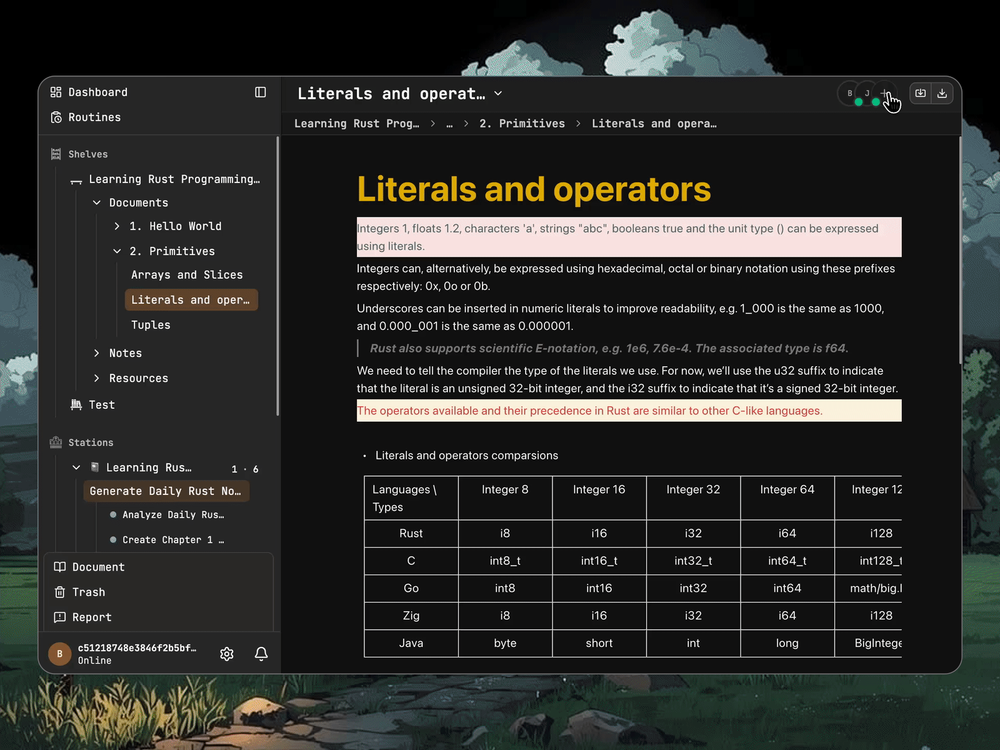

GIF 02 — Sharing and permissions

#### Editor topbar

The topbar provides the document name, participants, and import and export actions. Hover over an unfamiliar icon to read its hint. Import and export act in opposite directions, so check the action before selecting a file.

##### Import

Import reads a supported file into the current document as editable content, rather than preserving it as an attachment. Available formats include Markdown, plain text, HTML, and JSON that matches the document structure.

For a first import:

1. Create an empty Block Pack rather than testing on an important note.
2. Open the import menu and select a supported file.
3. Wait for the result, then check headings, lists, tables, and paragraph order.
4. Confirm that the content is suitable for editing before adding your own notes.

To keep an original file for reference, use Material. An imported document may not retain every aspect of the source file's layout or behavior.

JSON must follow the structure accepted by the editor; arbitrary JSON data cannot necessarily become a document. If a file is not recognized, check its format and content rather than changing its extension to bypass validation.

##### Export

Export downloads the current document in another format. Choose according to its intended use:

- For the main text, use plain text without expecting the full layout.
- For further work in text tools, consider Markdown and check the conversion of special Blocks.
- For a reading copy, choose PDF and inspect pagination and appearance.
- For another document tool, choose HTML, DOCX, or structured JSON as appropriate and check compatibility.

Not every Block looks identical in every format. Open the downloaded file and inspect tables, formulas, diagrams, and media before sharing or archiving it.

An exported copy is not a complete workspace backup, and not every export format can be imported again.

#### Editor item path

The path below the name shows the document's Root Shelf and Sub Shelf. If two documents are both named Research Summary, use the path to identify their projects.

The path identifies location and supports navigation; it is neither a permission control nor a local file-system location. Check it again after reorganizing categories.

#### Connection and saving feedback

When editing is unavailable, distinguish the possible causes:

- Still loading: wait for the document to be ready rather than repeatedly refreshing.
- Open but read-only: check your editing permission.
- Synchronization error: preserve your work, check the connection, and follow the available recovery actions.

If the interface requests resynchronization, read the confirmation and use an available export method to preserve important content where possible. Do not clear website data or reset local state while changes remain unconfirmed.

### Material viewer

#### File holder introduction

Open a Material to view its reference file. The website displays an image, audiovisual, PDF, or text preview according to its type. Read the source and write your summary separately in a Block Pack.

The name may appear before the content loads. For large files or slower connections, distinguish loading, unsupported content, and errors before deciding what to do. An empty view does not necessarily mean you need to create another Material.

To add your first reference file:

1. Open Items in a Sub Shelf's actions menu and select Material.
2. Open the new Material, choose Import from the File menu, and select or drag in a file.
3. Wait for import confirmation, then check the preview and item path.
4. To write reading notes, create a separate Block Pack in the same or a related category.

#### Supported file types

The preview interface covers the following types. This list describes preview capabilities, rather than upload limits or file-size requirements:

| Preview type | Supported formats |
| --- | --- |
| Image | PNG, JPG/JPEG, GIF, SVG, WebP |
| Video | MP4, WebM |
| Audio | MP3 |
| Document | PDF |
| Text | JSON, Markdown, plain text, HTML |

##### Read the preview

View images and PDFs directly, and use the provided playback controls for audio and video. Text previews display the file's contents, such as JSON, HTML, or Markdown source, rather than converting it into a Block Pack.

Visible HTML tags or Markdown syntax therefore do not necessarily indicate a display error. Use Block Pack for an editable document. HTML in a text preview does not run as a web page.

Audio and video playback also depend on browser decoding support. Files with the same extension may preview differently because of their encoding or condition.

##### When a preview does not load

Check three things first: whether the type appears in the preview list, whether the network is working, and whether the original file opens elsewhere. Different encodings can affect videos even when their extensions match.

If downloading is available and permitted, inspect the original in a suitable application. Changing an extension does not make the website understand a file, and a preview failure is not a reason to delete the only source copy.

#### Viewer topbar

The viewer topbar shows the Material's information and available actions. Check its name and type before proceeding, especially when files in different locations have the same name.

PDF previews provide zoom, page navigation, highlighting, text, and drawing tools. After adding annotations, choose Save annotations from the File menu to write them into the Material's PDF, or choose Download annotated PDF to download a copy. Wait for saving to succeed before leaving; annotations appearing on the page do not by themselves confirm that they have been saved.

#### Viewer item path

Use the path to identify the Material's location and return to its categories. Keeping reports and related summaries in nearby categories makes it easier to move between them.

[Watch on YouTube: Import and Read a PDF](https://youtu.be/xQ77zM2-PxM)

Video 04 — Import and Read a PDF

### Routine overviewer

This page brings together the time rail, charts, workflow definitions, and execution records. Start by deciding whether you need a task's configuration or the result of a particular execution, then choose the corresponding view.

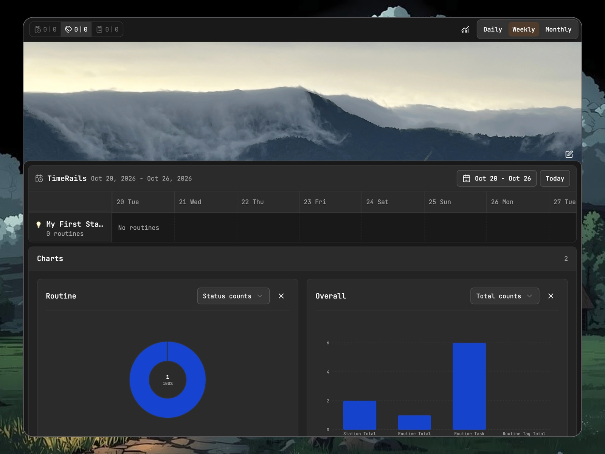

Image 15 — Routines overview

The example uses My First Station, which has no Routines, so the time rail shows No routines. Charts below may still show workspace-wide statistics; do not interpret every number as belonging to that Station.

#### Scope and filters

##### Choose what to show

The counts and selection controls at the top help identify the visible Stations, Routines, and tags. Open the relevant control, select the items you need, and apply the selection.

For example, keep only the Station for a research project when you want to focus on that work. Stations hidden by the filter have not been deleted; filtering changes only what you currently see.

##### Find a missing routine

Check that its Station is visible, then review tag and time filters. Untagged Routines may also be filtered out, so selecting only a few tags does not show every workflow in the account.

Tables may have their own conditions. Selecting the correct Station at the top does not clear a table's time or purpose filters. Check both.

#### Overview background image

The background changes the page's appearance, rather than tasks or execution times. If you set a background URL through a Station form, save that form. This is a different action from choosing a local Dashboard background.

#### Time rail

##### Change the visible time range

Choose a daily, weekly, or monthly scale. A shorter range shows nearby detail; a longer range helps you see the distribution of work. Date controls change the displayed period, and Today returns the view to the current date.

These controls change the visible time range, rather than a Routine's start or end time. Edit the Routine's settings to change its schedule.

##### Read a scheduled item

Identify the item's Station, Routine, and date, then compare its time and timezone with the configuration. A position on the time rail shows when work is scheduled, rather than whether it has completed.

Check execution records below to confirm success or failure. For recurring work, match the correct date so you do not mistake another execution's result for this one.

#### Charts

##### Add and choose a chart

If there are no charts, select Add charts in the chart area or use the add-chart control above. The picker groups options by overview, Routine, and Routine Task, with statistics for different questions:

- Totals: overall counts of related resources.
- Workflow status: the distribution of Routines by status.
- Recurrence: the periods used by workflows.
- Scheduled start and end times: the distribution of schedules over time.
- Task purpose: the distribution of Routine Task purposes.

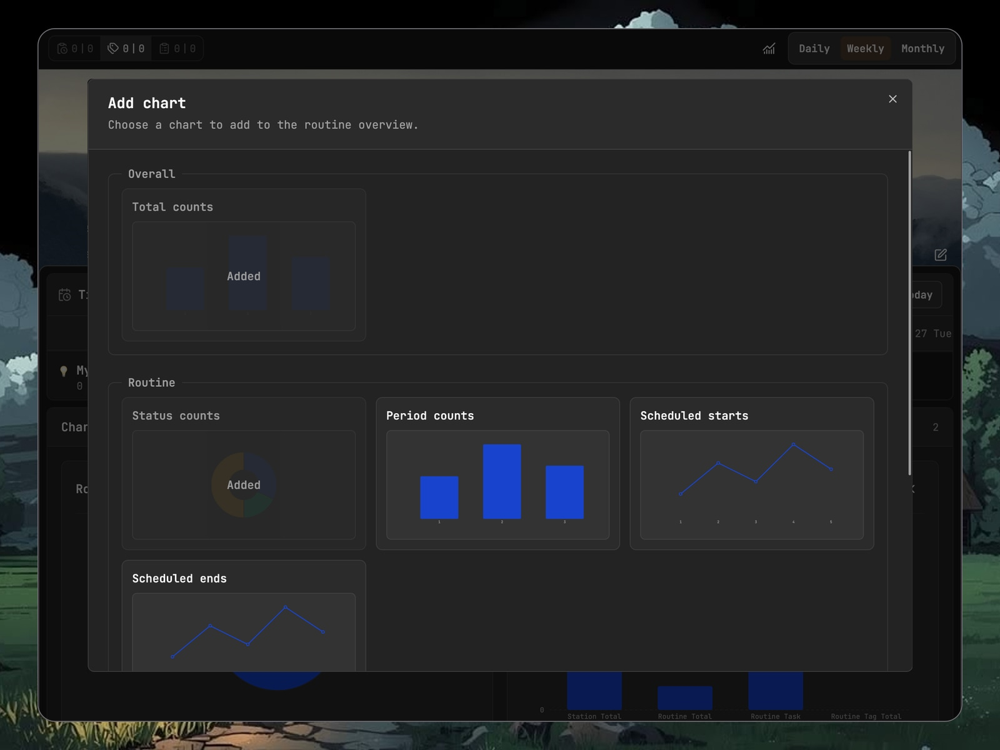

Image 16 — Chart picker

The charts in the picker are previews for recognizing a style, rather than actual account statistics. Add a chart before reviewing the data it loads.

##### Read and manage charts

Each chart has its own title and available metrics. Overview, Routine, and task charts may measure different populations. Do not assume every chart follows the same filters. Check titles and time ranges before comparing numbers.

Use a chart's metric menu to change the view, or its removal control when it is no longer needed. Removing a chart does not delete Routines or execution records.

An empty chart may mean no data matches the filters, that data is loading, or that an error occurred. Check lists and records before drawing conclusions from an unexpected chart.

#### Routine table

This table shows workflow definitions. Rows include the Routine, Station, status, schedule, tags, and task information, helping you identify where work belongs, when it is scheduled, and which steps it contains.

Use start and end time filters to find work, and check whether unscheduled items are included. If an item disappears after changing a time filter, inspect that condition before creating it again.

Open the row's details or Inspector to change the workflow. Current settings are not the result of the latest execution; use the next record table to investigate a particular run.

#### Routine execution record table

This table shows individual Routine executions. Find the workflow and scheduled time, then review its status, task counts, and completion information. Use available status filters to narrow the list and open the relevant record.

The current definition may have changed since an execution. When investigating past behavior, preserve the relevant record information rather than assuming today's settings describe what ran then.

#### Routine task table

This table lists task definitions, including name, Station, purpose, and owning Routine. Filter by purpose or workflow to find a step, then use its actions to inspect or edit it.

For similar task names, check the workflow and purpose. Open the task details or Payload editor to see its inputs rather than inferring the affected document from its name alone.

#### Routine task record table

This table shows individual task execution attempts. If a Routine does not produce the expected result, identify which task and attempt encountered a problem.

Use available status, schedule, and other filters, then open the details. Distinguish no matching records, loading, and read failures rather than treating all three as evidence that a task did not run.

An execution record is not an editable task definition. Change future work through task settings. When reporting a problem, retain the execution time and visible error information needed to identify that attempt.

#### Create your first routine

Start with test data and a single task. Understanding one simple step makes it easier to diagnose problems than adding a schedule, many tasks, and multiple dependencies at once.

##### Create a station

Select the add button beside Stations in the Sidebar and enter a name. Use a description to explain the work. Icons and backgrounds help identify the Station but are not execution requirements.

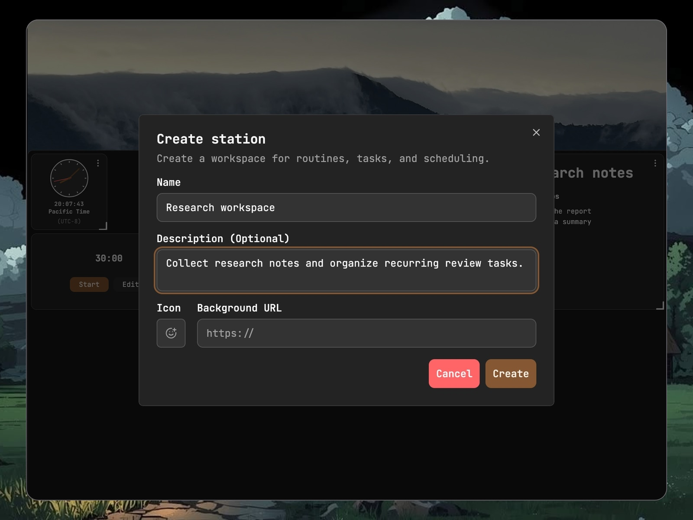

Image 17 — Station creation form

Confirm that the new Station appears in the Sidebar, then add a Routine from its menu. This helps avoid creating work in another project with a similar name.

##### Configure a routine

The Routine form requires a name and provides description, execution timeout, schedule, recurrence, and pinning options:

- Name and description: explain what the workflow does.
- Execution timeout: how long the work is allowed to run, rather than how often it repeats.
- Custom schedule: enable it to set start and end times. Without a custom schedule or recurrence, the workflow starts when activated. To pause work, deactivate it rather than leaving dates blank.
- Recurrence: whether to repeat and the daily, weekly, monthly, or other options provided by the interface.
- Pinning: makes the Routine easier to identify or access, rather than setting execution order.

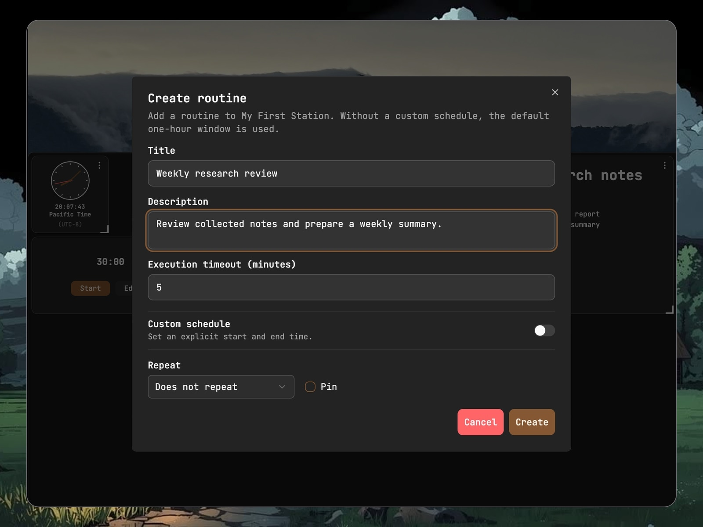

Image 18 — Routine creation form

##### Choose dates and times

After enabling a custom schedule, open the start and end pickers, select dates, and check hours and minutes. End conditions must satisfy the current recurrence's rules. Correct validation messages before submitting.

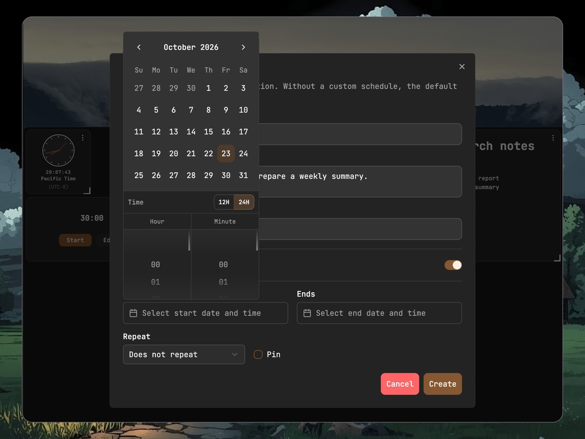

Image 19 — Routine date and time picker

After saving, check the timezone in the Routine's details. A displayed date does not mean every workflow uses the timezone you expect. If you are only exploring the form, cancel rather than creating work that may execute.

##### Add a task and check the result

When ready to create the workflow:

1. Create or select a Station you have permission to manage.
2. Create a Routine from the Station's actions and enter a meaningful name and description.
3. If scheduling is needed, configure its period and times and check the timezone.
4. Add a task to the Routine, select its purpose, and provide test resources as inputs.
5. Open the Routine's graph, add a Start node from the add menu, and connect it to the first task. Confirm that the intended Start node is active.
6. Select Save to save the graph and check that no unsaved changes or validation errors remain.
7. Review the schedule and timezone, then activate the Routine using Resume in the toolbar or Active in the Inspector. If the interface requires a future start time, correct the schedule before activating it again.
8. After execution, review the Routine and task records and open the actual content created or updated to confirm the result.

Once a single task is working, add another task and its dependencies. This makes it easier to distinguish input problems from scheduling or ordering problems.

[Watch on YouTube: Schedule a Routine and Check Its Results](https://youtu.be/H2PQbdqwrq0)

Video 05 — Schedule a Routine and Check Its Results

Main interactions play at 1.75x speed. The waiting interval plays at 4x, marked by `>> 4x`. The reference clock at the bottom right follows the recorded time to help compare it with the schedule.

### Inspector

Inspector opens an item's details without leaving the main work area. Choose Open in inspector from a Station or Routine menu to review its settings. Tasks and tags also have dedicated panels.

Check the name before editing. Similar-looking panels may change different things, such as a Station's name, a Routine's schedule, or a task's inputs.

#### Station inspector

Review and edit the Station's name, description, icon, and background. Use the name for identification and the description for its purpose or team context, rather than including every task's details.

Station appearance and identification are separate from Routine schedules. To change execution times, edit the relevant Routine.

#### Routine inspector

Review the Routine's name, description, status, schedule, timeout, and timezone. Active determines whether the workflow is enabled and is separate from its current execution status. For a weekly execution time, check the period and scheduled time; for allowed execution duration, check the timeout.

Save as directed by the form and check the result. Correct field validation messages rather than repeatedly submitting the same settings.

#### Routine task inspector

Review the task name, purpose, inputs, priority, and attempt settings. Check Payload to change the target resource; check dependencies to change ordering requirements.

Priority, attempts, and dependencies are different settings. If one step must follow another, configure the dependency rather than expressing it only through names or list order.

#### Routine tag inspector

Edit the tag's name, color, and icon. A purpose such as Research Preparation makes a useful name. Colors and icons help recognition but do not change execution order or permissions.

Read-only information in any Inspector is for reference. Do not edit identifiers manually to solve a problem. If actions are unavailable, check permissions, connection, and loading state.

### Routine task dependency graph editor

This graph configures work, rather than illustrating a note. It contains Start nodes and Routine Task nodes that perform actions. Connections define entry points and ordering requirements. Confirm the current Routine before editing so you do not confuse steps from different workflows.

#### Read the graph

For work that prepares data before processing and organizing it, the order might be:

```text
Start → Task A: Prepare data → Task B: Process data → Task C: Organize results
```

The workflow enters A from Start, B depends on A, and C depends on B. A node being farther left does not by itself make it run first; connection direction matters. Start nodes can connect to subsequent nodes but cannot accept incoming connections.

#### Create a dependency

To configure a simple sequence:

1. Confirm that both tasks belong to the current Routine.
2. Decide which task is the prerequisite and which depends on it.
3. Use the add-dependency action or graph connection controls to connect the prerequisite to the dependent task.
4. Check the direction and any cycle or validation messages.
5. Check saving and synchronization to confirm that the change has completed, rather than merely appearing on the canvas.

#### Check saving and sync

A visible connection is not necessarily saved to the server. After adjusting nodes or connections, select Save in the toolbar and confirm success. Saving, local drafts, pending synchronization, and validation failures require different responses.

For pending synchronization, check the connection and use the available retry action. For validation failures, correct relationships such as self-dependencies or cycles. Do not clear website data while an unsynchronized local draft remains.

Reload, retry, reset, and export are different actions. Export provides a copy of the current graph data, rather than execution results. Do not assume reset reverses all previously submitted changes. Check the current state before using an action, especially when you only intend to adjust node positions.

Removing a connection changes an ordering relationship; deleting a task affects a workflow step. Confirm which item you selected before proceeding.

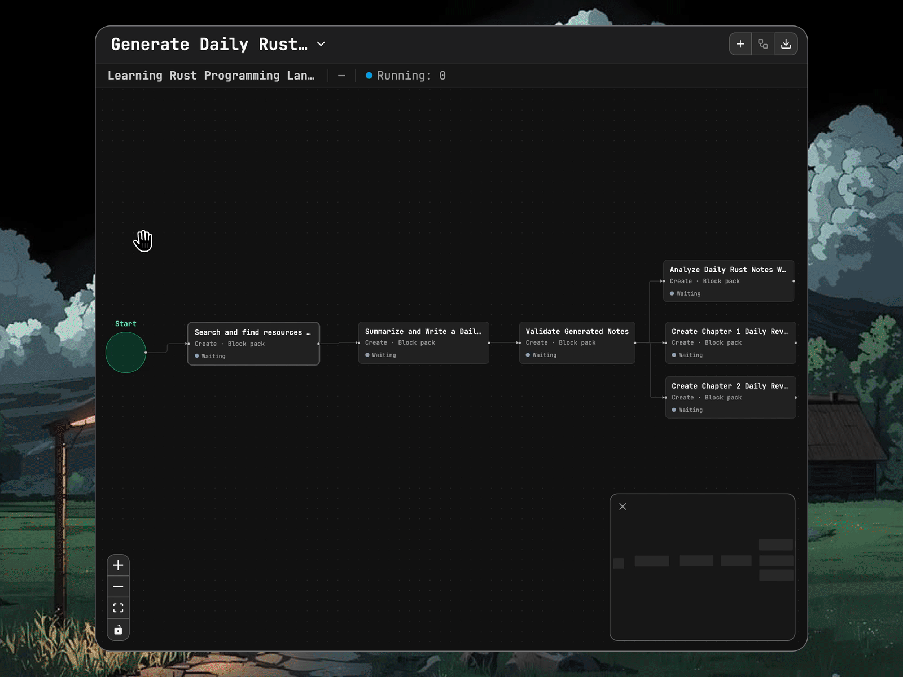

GIF 03 — Routine dependencies

### Routine task payload editor

A Payload supplies the data a task needs for its action. Creating a document requires a destination, name, and content; querying resources requires a target. Choose the purpose first, then configure its inputs rather than preparing JSON before deciding which task it belongs to.

#### Use a form

Some creation and update purposes have dedicated forms, including category, Block Pack, and Routine actions. Use them to select targets and enter data. Where a template editor is provided, configure the content to generate.

Check a target's project as well as its name. Documents with identical names may be different resources. Valid fields alone do not confirm that you selected the intended target.

#### Use JSON

Other purposes may provide a JSON editor. Follow the fields required by the chosen purpose rather than copying another task's inputs unchanged. Correct JSON syntax is only the first check; the target must exist, permissions must allow the action, and values must follow the relevant rules.

Website forms and the public API may support different operations. Consult the API documentation for programmatic integration rather than assuming every website purpose is a public endpoint.

#### Confirm and save

Configure inputs in this order:

1. Select the task purpose and open its input editor.
2. Select or enter the correct target resources.
3. Complete required content and review previews and validation messages.
4. Confirm the input editor's content and return to the task form.
5. Complete task creation or saving and check the final result.

Confirming the Payload editor does not necessarily save the whole task. Finish the outer task form as well. If you change the purpose, check whether the previous inputs still apply.

Reopen the same task to review its saved inputs against the purpose and target. Use test data for shared examples rather than publishing Payloads that contain credentials or private content.

[Watch on YouTube: Set Up a Document Creation Task](https://youtu.be/CvWLjJelp9A)

Video 06 — Set Up a Document Creation Task

For scheduling and execution results, see [Add a task and check the result](#add-a-task-and-check-the-result).

### Dialogs

Dialogs are used to create resources, adjust settings, edit inputs, and confirm deletion. Check the title, target name, and scope before filling in fields.

The usual sequence is:

1. Open the dialog from the relevant resource's actions.
2. Complete required fields and review format and validation messages.
3. Submit once and wait for the result rather than repeatedly confirming.
4. Return to the main view and check the new item or changed result.

Canceling or closing a dialog has different effects depending on the interface. Check for drafts or unsaved-change notices rather than assuming that closing always preserves content.

Deletion, leaving shared resources, transferring ownership, and resetting an account have different consequences. Read each confirmation. If confirmation text is required, understand the scope before entering it.

---

## Settings

Use account settings for personal details, sign-in methods, and keys. Use preferences for themes, display, editing behavior, and notifications.

Open them from the account or settings menu at the bottom of the Sidebar. Field names may vary with the interface language, but their purposes remain the same. Some preferences apply immediately; profile and other forms may require saving. Check the controls in the current section.

### Account settings

#### Profile and account information

##### Personal profile

Edit the avatar, cover, biography, and other profile fields provided by the interface. Check the crop preview after selecting an image, save the form after changing text, and confirm the updated result.

Not every field is required. Before sharing your screen or a screenshot, check for birthdays, locations, or personal details you do not want to disclose.

##### Account identity

Account information identifies the account and provides editable fields such as display name and status. A display name helps others recognize you; it is separate from the sign-in email address and resource ownership.

Read-only fields help you identify the account rather than provide settings to edit manually. Use the appropriate account modification flow to change a sign-in email or password. Changing a display name does not change how you sign in.

#### API keys

You do not need an API key to use the website. Manage keys in [account settings](/app/setting/account#api-keys) when an external application or tool needs integration.

##### Create a key

Decide the purpose and use a recognizable name, such as the application or environment that will use it. When the key is displayed, follow the instructions to copy it to trusted credential storage. Do not assume that the full value will remain available after closing the view.

Keep it out of frontend code, URLs, public notes, and screenshots. An API key allows programmatic requests with your authority; it is not a document link to share with collaborators.

##### Review and revoke

Check names and purposes before revoking unused keys. A program using a revoked key may stop working. For replacement, arrange the application's update rather than only deleting the old key on the website.

If you suspect exposure, stop sharing the key and follow the [API key guidance](/document#quick-start). Describe the purpose and error in a support report without including the key itself.

#### Upgrade and quotas

Review plans, usage, and limits here. If creation reaches a limit, inspect current usage before deciding whether to remove unnecessary content or consider another plan.

Storage, resource counts, and task execution usage are separate limits. Available storage does not mean every action is unlimited. Follow the message for the particular action and the information shown in your account.

Check your account for current plans, entitlements, and available upgrade actions.

#### Security

To verify an email address, begin with the corresponding security action, obtain the code as directed, and enter it to confirm. Check which account or address the verification concerns so you do not mix codes from different flows.

Enter verification codes only in a trusted verification view you opened intentionally. Do not send them to other people or include them in support reports. If sending is subject to a waiting period, wait before requesting another code.

#### Linked sign-in and recovery methods

This area covers linked sign-in methods and account contact or recovery information. Read the instructions for backup email addresses, phone numbers, and sign-in providers separately. Adding contact information does not create another account.

Complete verification where a code is required; a filled field does not mean linking has succeeded. Linking a sign-in provider may open that service for confirmation. Check the selected identity before proceeding.

Before changing sign-in methods, confirm that you can still access the same account afterward. Do not assume linking changes transfer projects, merge accounts, or revoke all existing access.

#### Account modification

These actions can substantially change an account. Consider each separately:

- Change email: affects account information or sign-in flows, rather than only the display name.
- Change password: start from a trusted page and complete the required verification.
- Reset account: may affect data and settings; read the scope of the specific action.
- Delete account: first confirm that you no longer need the account and its content, then address shared resources, important documents, and integrations.

Account reset and deletion are not routine fixes for display or loading issues. Save important work and consider effects on shared resources, collaborators, and integrations before proceeding. Do not assume recovery will be available afterward.

### Preference settings

Use [preferences](/app/setting/preferences) to adjust how you use the website. These are mainly choices for the current browser, rather than changes for every collaborator. Do not expect all preferences to synchronize automatically to another browser.

#### Appearance

Adjust the theme, interface language, density, and motion according to your needs:

- For unsuitable colors or contrast, try another theme.
- To change labels in buttons and menus, change the interface language. This does not translate your documents.
- To fit more information on screen, try a compact density; use a more spacious option if the view feels crowded.
- To limit animations, enable reduced motion.
- For subtle interaction responses, review the feedback options. Their effect also depends on device support.

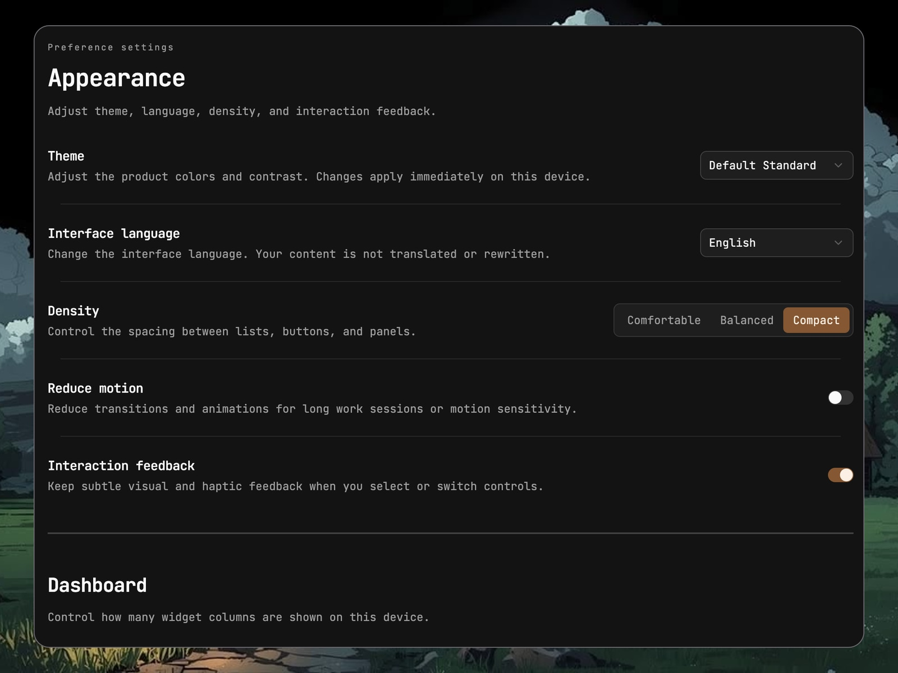

Image 20 — Appearance preferences

#### Dashboard

Choose whether to control Dashboard width manually. Automatic mode adapts to the current screen; consider manual control when you want a fixed wider or narrower arrangement.

This differs from moving a Widget. Use this preference for the whole workspace width, and resize the individual tool on Dashboard when you want a larger clock.

Before resetting Dashboard options, check whether the action affects local layouts or component content. Resetting preferences and deleting account documents are separate actions.

#### Editor

Editor preferences combine reading options and interaction tools. Open a test document and compare settings individually:

- Page width: choose a narrow, standard, or wider reading area. Try a narrower width if long paragraphs are hard to follow.
- Text size: adjust editor text on the current device for comfortable reading, rather than changing every paragraph into a heading.
- Word wrap: fit long lines to the available width rather than extending them horizontally.
- Spellcheck: use browser-provided checking, whose results depend on browser language and settings.
- Block drag handles: choose whether to show the controls used to move or manage Blocks.

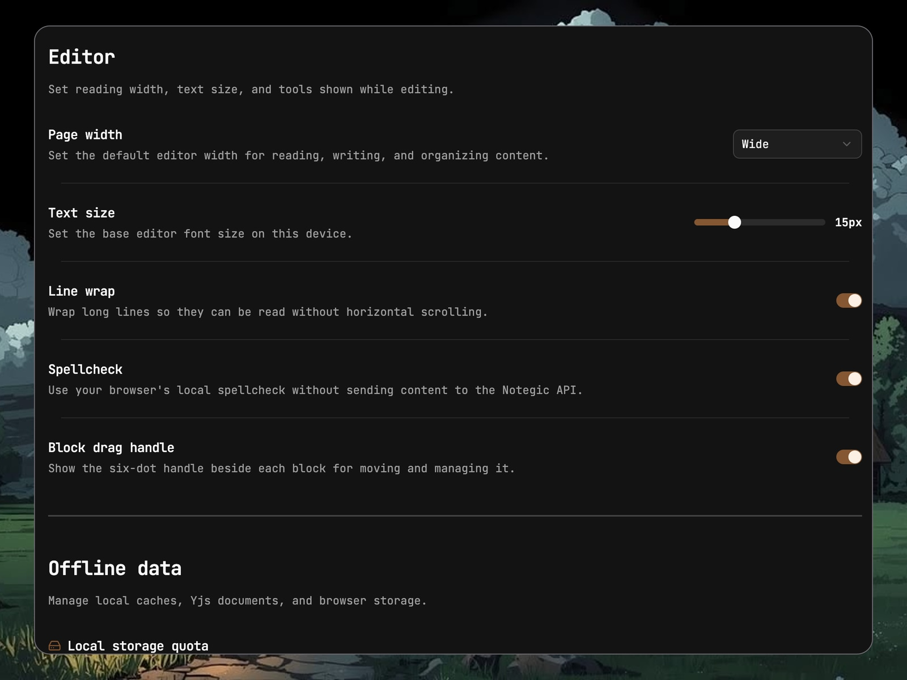

Image 21 — Editor preferences

#### Offline and local data

##### Understand local storage

This area shows website storage usage reported by the browser, including cached documents, backgrounds, and attachments. It describes this browser's data, rather than account-wide cloud capacity or shared storage across devices.

Local data, offline queues, and attachment caches control different things: retaining working data in the browser, queuing offline changes for reconnection, and keeping some attachments for later access. Enabling one does not make every feature available offline.

##### Reconnect safely

When returning after being offline, check for pending synchronization and errors before creating data again. Be especially careful with an action that was submitted but has not returned a result.

Sharing, permission changes, and some management actions require server confirmation. A visible note does not mean every operation can complete offline.

##### Clean up carefully

Cleanup schedules and cache actions affect local data. First save important Dashboard content, check for unsynchronized changes, and read which data will be removed. Do not clear all website data as the first response to a loading problem.

Review diagnostic data for private content before providing it to support. Downloaded data is not necessarily safe to publish or sufficient to restore the whole workspace.

#### Privacy

##### Start page and previews

Choose Dashboard or Routines as the start page according to your main work. Hiding preview titles reduces the note names shown in switchers and previews. Check the result before sharing your screen.

This does not anonymize the whole website. Review the screen before recording or sharing to avoid exposing document text, members, or other private information.

##### Clipboard protection

Clipboard protection provides configurable matching rules for supported sensitive-text handling. Test a custom rule with sample text first. Correct invalid or duplicate rules according to the message shown.

Reorder rules or remove unused entries as needed. This tool cannot guarantee detection of every secret and does not change account or document permissions. Review content before pasting into chats, public documents, or support reports. Check on-screen content separately when recording or sharing your screen.

See the [Privacy Policy](/document#privacy-policy) and [EULA](/eula) for data handling and terms of use.

#### Browser permissions

This area shows browser permission states for listed capabilities such as notifications, clipboard access, persistent storage, and location. A listed capability does not mean every feature uses it.

Allowed, denied, awaiting a prompt, and unavailable for querying are different states. If querying is unsupported, check browser support rather than repeatedly requesting access. You do not need to grant every permission to read notes.

Grant permissions when you need the corresponding feature. After a denial, you may need to change the browser's site settings and refresh the displayed state. Browser permissions are separate from Root Shelf and Station membership permissions.

Permission to retain browser data is not a substitute for backups. Clearing website data or losing a device may still affect local content.

#### Feedback

The feedback form provides categories for problems, feature requests, and other comments. Choose a type and write a short title. In the description, explain your goal, the steps you took, and what you observed.

Wait for the submission result instead of selecting the same control repeatedly. If sending fails, preserve your text and follow the message. Reports include the current page location and basic browser environment information to help reproduce the issue. You do not need to add account credentials or every internal diagnostic detail.

Before attaching images, hide private names, content, keys, and verification codes. Do not attach a whole private document or browser database simply to provide more information.

#### Notifications

Configure the desktop notifications, work reminders, and synchronization feedback provided by the interface separately. If a message is missing, first identify whether you expected an in-app message, temporary feedback, or a desktop notification that requires browser permission.

Quiet hours have start and end times for periods when you want fewer interruptions. Check their range after editing; this does not change a Routine's schedule.

A notification is a prompt, rather than proof of completion. Check the notification list or execution records for important work instead of concluding that nothing ran because no alert appeared.

#### About

Review the displayed version information and the actions for copying or resetting preferences.

Copying preferences places settings data on the clipboard; it does not export all notes, attachments, or Dashboard content. Review it before sending to support. Resetting changes personal options, so record settings you want to keep rather than using reset as a routine troubleshooting step.

See [Versions](/document#versions) for feature changes and the [EULA](/eula) for license terms.

### Full-page and sheet presentation

On supported screen sizes, the settings view can switch between a full page and a side sheet. Use a full page to review many settings, or a sheet for a small change while keeping the main work in view.

Complete any required form confirmation before switching presentation. Some settings apply immediately and others require saving; do not assume every section behaves the same way.

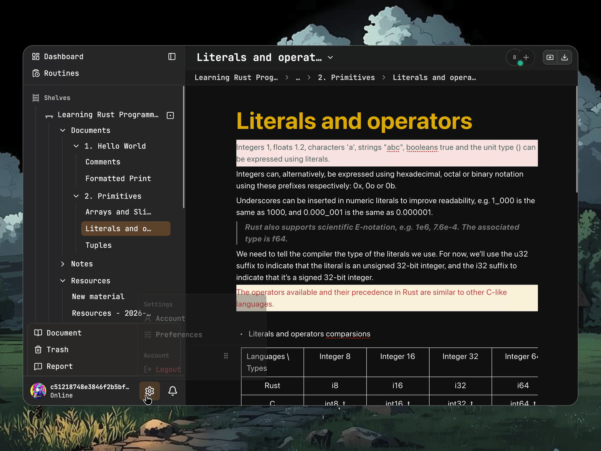

GIF 04 — Settings presentation switch

---

## Contact & Support

### Find the right information

Choose an entry point according to your goal:

- For website operation, read the relevant interface or settings section in this guide.
- For programmatic integration, see the [API documentation](/document#gateway) and [API key guidance](/document#quick-start).
- For released changes, see [Versions](/document#versions).
- To report a problem or suggest a feature, use Report in the Sidebar or Feedback in preferences.

### Before reporting a problem

Begin with checks that preserve your data:

1. Confirm the signed-in account, selected resource, and active filters.
2. Check connection, loading, and visible error messages.
3. For access problems, ask a resource owner to check membership and roles.
4. Record the time and the actions immediately before the issue.
5. Preserve unsaved or unsynchronized content before taking further recovery steps.

Do not begin by clearing website data, resetting an account, or deleting a resource. These actions can remove local content and make the issue harder to investigate.

### A useful problem report

A report does not need to be highly technical. Explain how someone can reproduce the issue. For example, I cannot type after opening a particular document is more useful than It is broken. Use this template and fill in what you know:

```text
Page or feature:
What you were trying to do:
Expected result:
Actual result:
Steps to reproduce:
Browser and operating system:
Time and timezone:
On-screen error message:
Screenshot or recording with sensitive information hidden, if available:
```

Share only the information needed for investigation. Provide document URLs, resource identifiers, or file content only when necessary and through a trusted support channel. Do not include API keys, passwords, verification codes, session information, or private signed links.

### Common situations

- Missing document: check the Root Shelf, collapsed categories, account permissions, and applicable Trash entries before creating a duplicate.
- Editor unavailable: check read-only access, loading state, and synchronization errors.
- Material preview unavailable: check the file type, connection, and loading result. If downloading is available, inspect the source in an appropriate application.
- Unexpected automation result: inspect the correct Routine and task execution records, including time range and inputs.
- Different layout in another browser: distinguish browser-local customization from shared account data; not every setting synchronizes.
- Unclear action result: inspect lists and status before retrying, particularly for creation, deletion, or other data-changing actions.

If these checks do not resolve the issue, report reproducible steps and appropriately redacted screenshots or recordings. You do not need to expose your entire private workspace.
