# Website

> 本文件是供你審閱、調整的中文草稿，尚未接到公開的 Document 頁面。標題保留英文，內文使用中文；截圖來自本機網站的示範操作。介面中的英文名稱可能會隨語言設定不同而改變。`<placeholder>` 只用來標示之後要補錄的影片，不是可播放的內容。

Notegic 是用來寫筆記、整理參考檔案，以及安排重複性工作的網站。你可以只把它當作筆記工具，也可以邀請其他人一起編輯，或再加入自動化任務。不需要一次學會所有功能，先完成手上的一件事就好。

這份指南從建立第一份筆記開始，再介紹各個頁面的按鈕、設定和使用方式。你可以從頭讀，也可以直接找到自己正在使用的功能。如果你是要寫程式連接 Notegic，請改看 [API 文件](/document#gateway)；這裡主要說明人在網站上怎麼操作。

## Beginning

### Demonstration

第一次開啟網站，可以先認識三個地方：Dashboard 是可以放小工具的首頁；側邊欄讓你找到文件和參考資料；Routines 頁面則用來管理自動化工作。當你只想寫筆記時，先使用側邊欄和文件編輯器就夠了。

以下會用「研究專案」作為例子。我們先建立專案分類，把下載的報告和自己寫的摘要分開保存，再示範怎麼找回它們。後面的自動化章節會接著說明，如何設定一項工作，以及到哪裡查看它的執行結果。

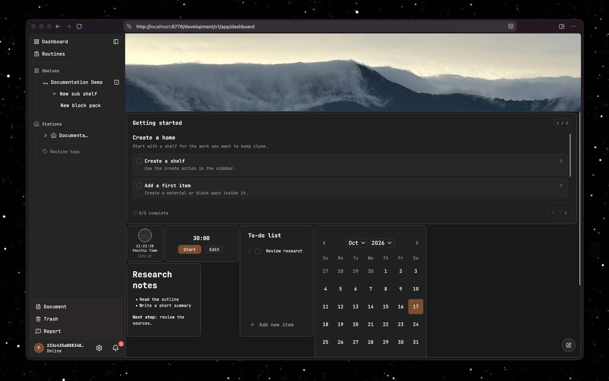

注：我們將會在之後的章節更多的談到 (Widgets)[]，在那之前你只需要知道他是一個可以在 Dashboard 當中提供總覽或者方便你使用的一些小工具。

上圖的 Getting started widget 提供您初始導覽，可以逐項展開閱讀，右下方的按鈕點擊可以進入針對 Dashboard 以及其 Widgets 的編輯模式。

`<placeholder>` 影片：網站快速導覽。從 Dashboard 出發，展示側邊欄中的儲存區與自動化區，再開啟一份 Block Pack 和一份 Material。結尾回到已建立的研究摘要，讓觀看者知道完成後的內容放在哪裡。

我們也提供簡略的導覽影片，但你也可以直接依照下方文字開始上手操作，這樣能讓你更能夠掌握軟體的各項功能，至於更多的細節，我們將在後續章節的對應位置提供更聚焦的操作示範。

### Big picture

#### What can this app do?

你可以把不同專案分開整理，再把文件、參考檔案放進合適的分類。寫文件時，不只是輸入一大段文字，也能使用標題、清單、表格、程式碼、公式和圖表等內容。這些小單位稱為 Blocks，合在一起就是一份我們稱之為 Block Pack 的文件。

需要共同工作時，可以在有權限的 Root Shelf 中和其他人編輯文件。需要重複執行工作時，則到 Station 建立 Routine，再加入個別的 Routine Tasks。網站會把設定與執行紀錄分開，讓你可以分別確認「我設定了什麼」和「這次實際執行了什麼」。

如果目前只需要寫筆記或是記錄一些事情，可以先忽略自動化功能；你不需要建立 Routine 或 API key 等其他功能，就可以先開始體驗筆記。

#### Why this app?

當資料分散在檔案、筆記與不同工具之間，往往不容易確認某段內容的來源，或找回上次整理到一半的工作。Notegic 的使用方式，是先讓每份內容有清楚的位置與用途，再逐步加入需要的工作流程。

例如，研究報告的原始 PDF 可以作為 Material，閱讀後的觀點與摘要則寫進 Block Pack。這兩者彼此相關，但不會被混成同一種內容：前者保留參考來源，後者是你持續修改與維護的文件。

這樣的結構適合長期累積的學習筆記、研究資料、專案文件與團隊知識。它不要求你一開始就建立很複雜的分類，也不會因為有自動化功能，就要求每項工作都必須自動執行。

#### How can we get started?

先用一個小專案完成第一次操作：

1. 登入網站，從 Dashboard 或側邊欄進入工作區。
2. 在側邊欄的 Root Shelves 區域按下新增按鈕，建立名為「研究專案」的 Root Shelf。
3. 開啟該 Root Shelf 的操作選單，新增一個 Sub Shelf，例如「主題整理」。
4. 開啟 Sub Shelf 的操作選單，在 Items 子選單選擇 Block pack，建立後將文件命名為「研究摘要」。
5. 開啟文件，加入標題、一小段摘要與待確認事項清單。
6. 透過側邊欄切換到其他畫面，再返回同一份 Block Pack，確認你能再次找到它。
7. 離開前，檢查畫面是否仍有載入、同步錯誤或待處理的提示。

完成後，你會有一個可以繼續擴充的專案，而不只是暫時開著的編輯畫面。接下來再依需求增加 Sub Shelves、其他文件或參考 Materials 即可。

桌面介面的項目操作通常可以從右鍵選單開啟。如果看不到預期的操作，先確認目前選取的是 Root Shelf、Sub Shelf 還是文件，以及帳號是否具備對應權限。

`<placeholder>` 影片：第一次建立研究筆記。完整錄製建立 Root Shelf、加入 Sub Shelf、建立並命名 Block Pack、輸入內容，以及從側邊欄重新找到文件的流程。

### Future development

以下是規劃中的發展方向，不代表目前已可使用，也不構成特定日期的推出承諾。已發布的變更與近期規劃，請以 [Versions](/document#versions) 為準。

#### AI & RAG in routine tasks

我們希望讓自動化工作能更有效地結合既有筆記與參考內容，而不是每次都重新輸入相同背景。未來的 AI 與檢索輔助功能，將以實際的資料整理與工作需求為出發點。

相關功能正式提供時，會另外說明可使用的資料範圍、存取限制與結果確認方式。

#### MCP and tool calling

我們正在評估如何讓對話與工具操作更自然地銜接。重點不只是產生回答，也包括讓使用者理解準備執行的操作，以及操作可能影響哪些內容。

具體支援的工具、連接方式與操作確認流程，會在功能可用時另行說明。目前的操作指南不依賴這些尚未推出的能力。

#### Chat AI and note assist AI

未來的對話介面將朝更進階、也更容易理解的方向發展，並結合既有筆記結構，讓對話成果更容易整理成有格式、可繼續編輯的內容。

我們希望對話能成為持續整理知識的一部分，而不是與文件完全分離的訊息串。實際功能與使用方式仍會隨開發調整。

#### More components for learning and researching

除了文件與參考資料，我們也在探索更適合學習與研究的內容形式。這些構想會先以具體用途評估，再決定是否加入產品；不需要為尚未推出的元件，預先改變目前的資料整理方式。

### Currently working on

目前主要方向是 AI 整合，以及讓對話介面更能配合 Notegic 的筆記架構。同時，我們也會持續改善既有功能的操作一致性、文件說明與排程使用體驗。

如果你想了解哪些變更已經推出、哪些仍在規劃中，請查看 [Versions](/document#versions)。這裡先介紹我們正在做的方向；確認可以提供的功能後，再更新對應版本的說明。

---

## Component

### Structured storage

儲存區用階層整理內容，並將「分類」、「可編輯文件」與「參考檔案」分成不同角色。以下是一個簡單的研究專案：

```text
研究專案（Root Shelf）
└─ 主題整理（Sub Shelf）
   ├─ 研究摘要（Block Pack）
   │  └─ 標題、段落、清單等 Blocks
   └─ 參考報告（Material）
```

這個例子用來說明各種內容如何配合；實際可新增或移動的位置，請依目前選單提供的操作為準。

#### Root Shelf

Root Shelf 可以先理解成一個專案或一組資料的最外層分類。它下面可以繼續放 Sub Shelves，再收納筆記與參考檔案。誰能存取這組內容，也需要從所屬的 Root Shelf 確認。

例如，個人研究與團隊專案可以分開放在不同的 Root Shelves。命名時，讓名稱直接反映用途，比使用「資料夾一」這類名稱更容易辨認。

建立時，在側邊欄的 Shelves 標題旁按新增，輸入名稱並確認。之後可以展開它，或從操作選單新增分類、重新命名，以及使用自己有權執行的管理功能。

管理選單中的刪除、離開與轉移擁有權不是同一件事：刪除影響這份資料，離開是讓自己退出共享內容，轉移擁有權則是把管理責任交給另一個成員。執行前，先讀清楚確認畫面顯示的名稱與影響。

#### Sub Shelf

Sub Shelf 就是專案裡的下一層分類，也可以再往下分。你可以按照主題整理，例如「方法」、「案例」、「參考資料」；也可以按照工作階段整理，例如「待閱讀」、「整理中」、「已完成」。不需要先替所有可能的資料建立空分類，等真的需要時再加即可。

在 Root Shelf 的操作選單新增第一個 Sub Shelf，再從 Sub Shelf 的選單新增下一層分類、Block Pack 或 Material。單純多分一層資料夾，不代表另外建立了一套獨立權限；要分享給不同的人，仍要確認所屬 Root Shelf 的存取安排。

移動項目後，請檢查側邊欄與項目路徑，確認它確實位於預期位置。若找不到內容，先檢查分類是否收合，而不是立刻建立另一份副本。

#### Block Pack

Block Pack 就是你在 Notegic 裡撰寫的文件。點開後可以輸入文字、安排段落，也能加入其他 Block 類型。它適合研究摘要、會議紀錄、專案說明，或任何會反覆補充與修改的筆記。

每份 Block Pack 都應有清楚的名稱，讓你能在側邊欄與路徑中辨識。文件的顯示寬度或字體大小屬於閱讀偏好，與文件本身的內容不同。

如果需要與他人共同處理文件，請先確認對方具備所屬 Root Shelf 的存取權限。傳送網址本身不會自動授權。

#### Material

Material 是放在 Notegic 裡的參考檔案，例如 PDF 報告、圖片、音訊或影片。最簡單的分法是：想保留一份原檔來查看，用 Material；想自己寫內容、修改段落，用 Block Pack。

你可以把原始研究報告放在 Material，再將重點整理到 Block Pack。這樣能保留來源與自己的觀點之間的區別，也更容易在需要時回頭查看原檔。

Material 能否預覽取決於檔案類型、內容與瀏覽器支援。上傳或開啟檔案不代表它會自動轉成可編輯文件，也不代表會自動執行 AI 分析。

#### Block

Block 是文件中的內容單位。標題、段落與清單等內容，可以各自以適合的方式編輯與排列。

剛開始時，先用少量 Blocks 建立清楚的結構即可。例如一個標題、一段摘要與一份待辦清單，通常比一開始加入許多不同類型的內容更容易維護。

### Automation

自動化不是另一種筆記分類，而是用來安排「要做什麼、何時做、哪一步要先做」。你會遇到設定與紀錄兩種畫面：

- 定義：你設定了什麼流程、任務與相依關係。
- 紀錄：某次執行實際發生了什麼，以及最後的狀態。

改變定義不等於已成功執行；看到排程也不等於已產生結果。

#### Station

Station 是一組自動化工作的集合。你可以把它想成放置相關 Routines 的地方，例如一個 Station 管研究整理，另一個管專案維護。新增工作前，先選好 Station，之後比較容易找回和管理。

Station 的存取權限與 Root Shelf 分開管理。能閱讀某份筆記，不代表就能管理所有與筆記相關的自動化工作。

#### Routine

Routine 是一項工作的設定，包含名稱、說明、排程和其中的任務。例如「每週研究整理」是一個 Routine，而它本週有沒有執行成功，是另外一筆執行紀錄。修改 Routine 是改之後使用的設定，不是修改過去的結果。

建立時，先用名稱說明用途，再補上必要的描述。設定排程時，檢查週期、開始與結束條件，以及介面顯示的時區；之後若調整時間，也要重新確認這些設定是否仍符合需求。

不要只因 Routine 已建立，就認為其中任務已執行完成。實際結果應回到執行紀錄查看。

#### Routine Task

Routine Task 是 Routine 內的一個操作步驟。每個任務都有操作用途與所需輸入，並可依介面提供的選項設定優先權與嘗試次數。

建立任務時，先想清楚「要對哪個資源做什麼」，再選擇對應用途並填寫輸入。任務名稱應描述目的，例如「建立本週摘要文件」，而不只是「任務一」。

第一次設定時，請使用不含重要資料的測試內容。對於更新或刪除資料的操作，應先確認影響範圍，不要直接在重要專案上測試。

#### Routine Task dependencies

相依關係就是告訴網站「這一步要等哪一步先做」。例如 B 要使用 A 建立的內容，就需要先安排 A，再讓 B 依賴它。圖上會用 A 指向 B 的連線表示這個關係。

只應連接同一個 Routine 內有實際先後需求的任務，避免建立循環。畫面上的連線與儲存狀態要一起看：尚未同步或驗證失敗的變更，不能當成已確認的執行條件。

前置任務失敗或沒有執行時，請查看相關紀錄與狀態，不要只憑箭頭推定後續任務一定會執行。

#### Routine Tag

Routine Tag 用來為 Routines 分類，方便將相關工作集中查看。它不是任務，不會因為建立或套用標籤就執行工作。

你可以依用途或工作領域設定標籤，例如研究整理、每週回顧或專案維護。篩選時也要留意未套用標籤的 Routines，避免把被篩選隱藏的工作誤認為已刪除。

### Future (not implemented)

Learning Card 與 Exam 是目前仍在探索的內容形式，尚不屬於本指南中的可用操作。

Learning Card 的方向是協助將內容轉化為適合反覆練習的學習單位；Exam 則是評估學習成果的可能形式。具體欄位、操作與推出範圍尚未確定，因此目前不需要為這些構想預先建立資料或調整既有筆記。

---

## User Interface

### Dashboard

Dashboard 是你的工作首頁。可以放時鐘、計時器、待辦和便條，讓你一進網站就看見今天需要的資訊。這些工具不會改變側邊欄的文件分類；整理筆記仍然到 Shelves，管理自動化則到 Routines。

#### Header background image

進入 Dashboard 版面編輯後，頁首會出現更換背景的提示。開啟圖片選擇，再依畫面調整裁切和位置，確認預覽沒有切掉你想保留的部分後完成操作。不必為了換背景去改筆記或 Station 的設定。

Dashboard 的背景與個人版面屬於目前瀏覽器的自訂內容。換用其他瀏覽器或裝置時，不應預期它們會自動出現；清除網站資料也可能移除這些設定。

#### Widgets

Widget 是放在 Dashboard 上的小工具。先從內建工具選一個，再調整位置與大小，不需要編寫程式。每種工具的按鈕不同，下面會先介紹它能做什麼，再說明怎麼新增、編輯與保存。

這一節用多張圖片搭配步驟說明，不需要另外觀看影片。

##### Defaults

這裡的 Defaults 指網站已提供、可以直接加入的工具，不代表每個工具都會在第一次開啟時自動出現。新增視窗分成基本工具與引導內容，你可以依需要選擇。

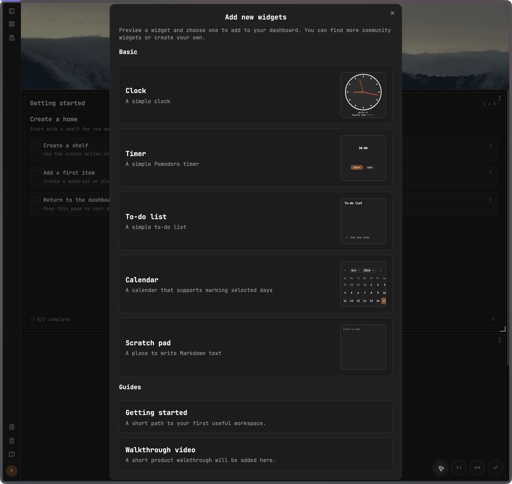

預覽幫助你辨認工具，不能在預覽小圖裡直接操作。點選想要的項目後，工具才會加入 Dashboard。之後也可以再加其他工具，不需要一次把整個頁面排好。

###### Clock

時鐘適合放在需要經常看時間的位置，也可以用來顯示另一個地區的時間。加入後，先確認它顯示的地區；預設時區不一定就是你所在的地方。

從 Widget 的選單開啟 Edit，可以看到以下控制項：

- 時區：選擇要顯示的地區時間。這只改這個時鐘，不會順便更改 Routine 排程的時區。
- 時鐘樣式：選擇不同鐘面外觀，例如傳統、簡約或現代樣式。
- 數字時間：決定是否在鐘面之外顯示時、分、秒。
- 地區名稱：決定是否顯示所選地區與時區資訊。
- 文字大小：分別調整數字時間與地區名稱，不需要把整個網站一起放大。

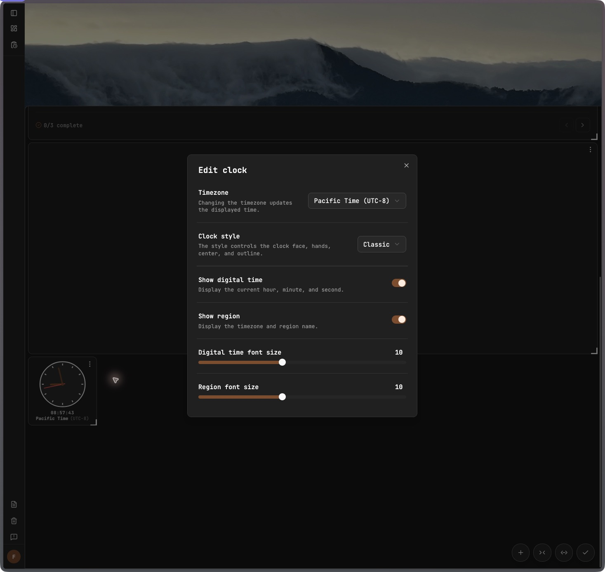

如果你想知道自己為什麼看到不同時間，先看時區，不要直接修改電腦時間。若只覺得文字擠在一起，先增加 Widget 尺寸，或調小這個工具的文字即可。

###### Timer

計時器用來替一段工作倒數，例如先讀三十分鐘，再整理筆記。它是倒數工具，不會因為開始計時就建立 Routine，也不會自動幫你執行待辦事項。

一般操作分成幾個狀態：

1. 尚未開始時，按 Edit 調整小時、分鐘和秒數，再按 Save 保存這次設定的時間；不想變更則按 Cancel。
2. 按 Start 開始倒數。
3. 需要暫停時按 Pause，之後用 Resume 接著倒數。
4. 按 Reset 回到目前設定的起始時間；它不是繼續按暫停前剩餘的時間。

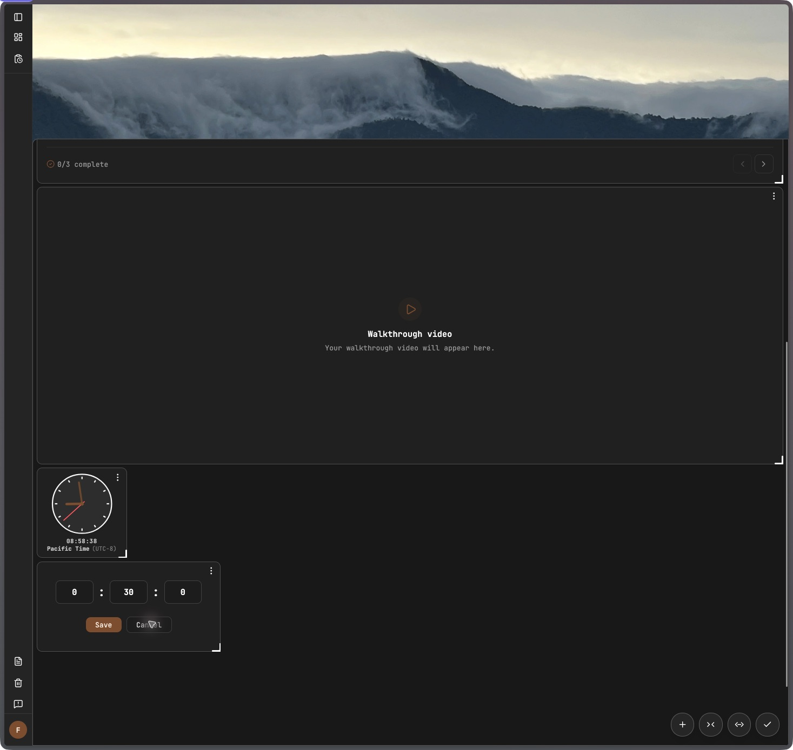

計時器本身的 Edit 是改倒數時間；Widget 選單中的 Edit 則是改外觀，例如倒數文字與按鈕的大小。設定中的安靜模式會隱藏操作按鈕，不要把它理解成保證提供或關閉某種提示音的開關。

需要操作按鈕卻看不到時，可以先回到 Widget 設定檢查安靜模式。也不要把倒數當成可靠的背景鬧鐘：關閉網頁、重新載入或瀏覽器限制背景執行時，不能假設計時會完整接續或一定發出提醒。

###### To-do list

待辦清單適合放今天要做的幾件小事。它不會建立自動化任務，勾選完成也不會觸發 Routine。

你可以依這個順序開始：

1. 點清單標題，改成容易辨識的名稱，例如「本週研究」。
2. 按 Add new item 新增一列，再輸入要做的事情。
3. 需要調整順序時，拖曳該列左側的把手。
4. 完成一項後勾選方框，文字會改成已完成的樣式。
5. 有變更時，按清單內的 Save changes 保存。不要只因為畫面上已經出現文字，就以為已完成保存。

將游標移到項目上，可以看到該列的其他操作，例如附加連結與移除項目。連結適合放閱讀來源或相關頁面；開啟外部網址前，先確認是你信任的位置。

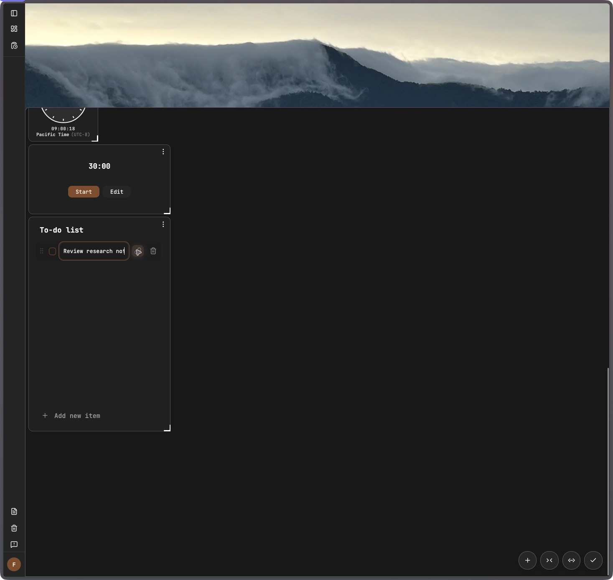

上圖是已保存的清單，因此沒有顯示 Save changes；再次修改內容時，才會出現需要保存的提示與按鈕。

Widget 外觀設定可以調整標題字體、項目字體和每列高度。若內容很長，可以先放大工具或調整字體，不必為了顯示得下而刪掉重要文字。

###### Calendar

行事曆適合查看日期，或在思考安排時選一個日期作為參考。可以用月份與年份選單跳轉，也可以用左右箭頭前後切換，再點選需要的日期。

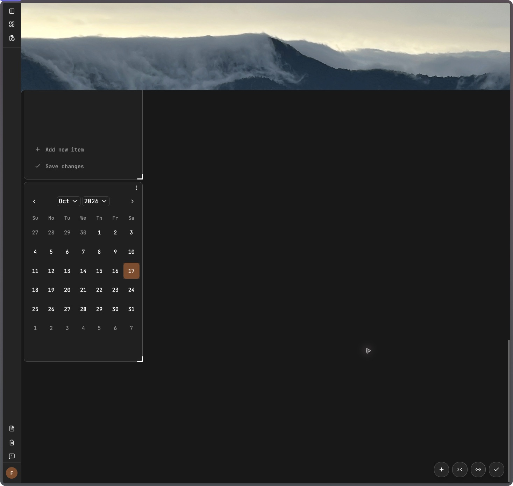

這個 Widget 目前不是事件管理工具。點某個日期不會建立行程、不會修改 Routine，也不會替那一天加入提醒。若你要設定工作的執行時間，請到 Routine 的排程設定處理。

行事曆沒有和時鐘相同的專用外觀設定面板，但仍可透過 Dashboard 的版面編輯移動或調整允許的尺寸。

###### Scratch Pad

Scratch Pad 是 Dashboard 上的便條，適合暫記想法、下一步工作或短篇備忘。點進工具就能開始編輯文字；離開文字輸入區後，會回到閱讀模式。

它支援 Markdown，所以你可以輸入標題、清單、粗體等基本格式。例如輸入 `# 研究備忘` 作為標題，再用 `-` 開頭列出待整理內容。編輯時看到的是文字語法，閱讀時則會呈現對應的格式。

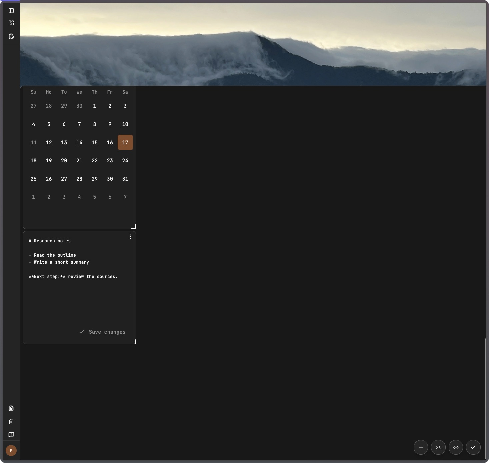

完成修改後，記得按便條內的 Save changes。點到外面讓它切回預覽，和按下保存不是同一件事。外觀設定還能調整文字大小，方便配合便條尺寸閱讀。

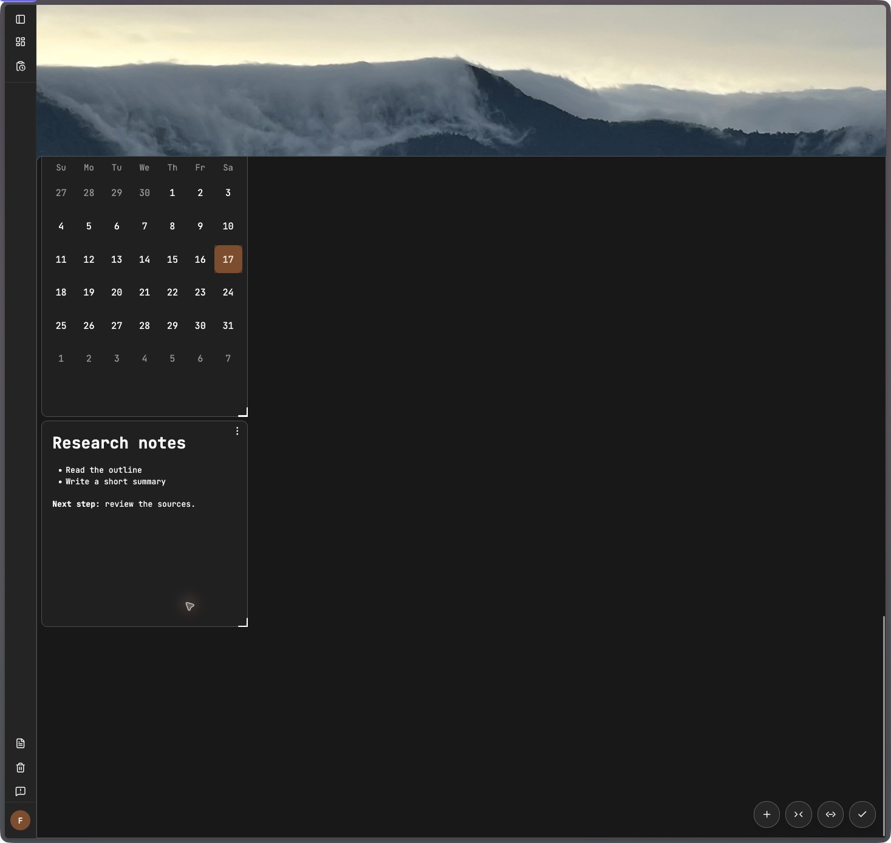

便條內容保存在目前瀏覽器，不是供團隊共同編輯的文件。需要長期保存、分享或完整整理的內容，請移到 Block Pack，而不是只留在便條裡。

###### Getting started

這是分頁式的入門清單。每一項可以展開，閱讀該步要做什麼；完成後再自行勾選。下方顯示目前頁面的完成數，左右按鈕則用來換頁。

勾選代表你對自己的進度做標記，不是網站已經替你建立資料。勾選「建立分類」之後，仍要到側邊欄實際建立；反過來說，若你已完成操作，也可以回來補上進度。

第一次不想閱讀全部內容時，可以先完成第一頁，再繼續自己的工作。清單不要求你一次走完所有自動化功能。

###### Walkthrough video

這個工具用來顯示產品引導影片。如果目前顯示「影片之後會放在這裡」之類的文字，代表尚未提供影片，不是你的瀏覽器播放失敗，也不需要為此開啟額外權限。

Getting started 與 Walkthrough video 是引導內容，版面可能橫跨整個工作區寬度，與小型時鐘的排列方式不同。兩者目前沒有一般 Widget 那樣的外觀編輯面板。

##### Usage

使用 Widget 時，最容易混淆的是三件事：調整工具在頁面上的位置、修改工具外觀，以及輸入工具裡的內容。它們的入口不同，也不一定共用同一個保存按鈕。

###### Add a widget

按 Dashboard 右下方的鉛筆圖示，進入版面編輯。這時會出現新增、寬度調整和完成按鈕，工具邊緣也會顯示操作控制。

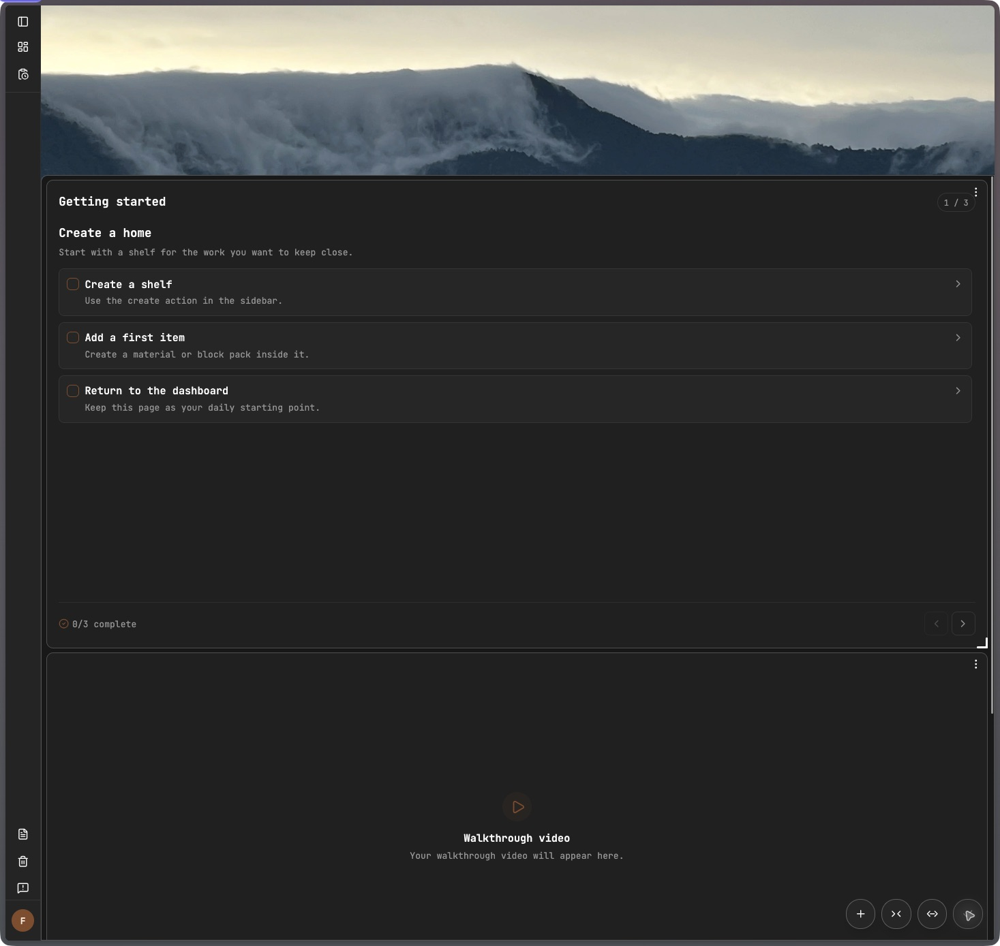

按右下方的加號開啟新增清單，選擇工具後就會加入頁面。如果畫面上出現帶加號的空白格，也可以從那裡開始新增。新工具不一定會在目前視線內，必要時往下捲動查看。

先加入一兩個工具，再逐步安排版面，比一次加入很多工具更容易知道自己正在改哪一個。

###### Move and resize

在版面編輯模式中，可以拖曳工具到允許的位置，並利用右下角的尺寸把手調整大小。工具會依網格與支援尺寸排列，不是每個工具都能任意拉成任何大小。

如果只能調整到幾種尺寸，那是該工具提供的選項，不一定是拖曳失敗。時鐘、行事曆與較長的待辦清單，各自適合的尺寸也不同。

右下方的縮窄／放寬按鈕調整的是整個 Dashboard 可用寬度，不是單一 Widget 的字體或大小。工具太擠時，先分清楚要調哪一層。

###### Edit a widget

版面編輯時，工具上的三點選單會提供可用操作。具有專用設定的工具可以開啟 Edit；不是所有工具都會有同樣的選項。

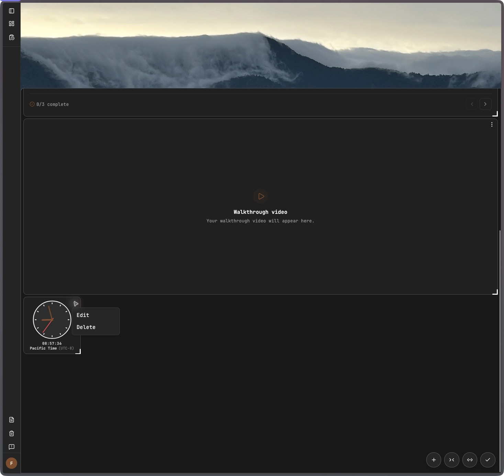

進入設定後，依前面的各工具說明調整。這與在計時器內改倒數秒數、在待辦內輸入工作內容不同。完成外觀調整後關閉面板，再回到 Dashboard 完成版面編輯與保存。

###### Save your changes

安排好位置與尺寸後，按 Dashboard 右下方的勾選按鈕，保存版面並離開編輯模式。之後再開始操作計時器或輸入內容，就比較不會誤拖整個工具。

待辦與 Scratch Pad 另外有自己的 Save changes，修改內容時也要完成這一步。最簡單的記法是：移動位置後保存 Dashboard，寫內容後保存正在編輯的那個工具。

這些資料保存在目前瀏覽器。清除網站資料、改用另一個瀏覽器或更換裝置後，不能預期整份 Dashboard 會自動跟過去。請把重要文件放在適合長期保存的位置。

###### Remove a widget

移除前，先確認工具裡有沒有要保留的便條或待辦。選單中的 Delete 是移除整個工具，不是只關閉設定視窗，也不是只移除某一列待辦。

不確定是否還需要內容時，先另外保存，再處理工具。不要把 Dashboard 的移除操作當成可以隨時從垃圾桶找回的流程。

##### Customized

這裡指的是之後可能提供的自製 Widget 或其他擴充方式，目前尚未實作。本指南不提供安裝社群元件、上傳自製工具或撰寫 Widget 程式的操作步驟。

已經可用的時區、字體、工具尺寸與版面調整，仍然可以照前面的說明使用；「尚未實作」說的是擴充新的工具種類，不是所有外觀調整都不能用。未來若開放擴充，會另行說明可以提供哪些內容與如何使用。

#### Other interactive UI components

畫面上的按鈕可能分別控制版面、元件內容或整個資源。操作前，先確認按鈕所屬範圍；刪除一個 Widget 與刪除一份文件，影響並不相同。

儲存或載入期間，部分控制項可能暫時停用。請等候結果提示，不要因為畫面沒有立即改變就連續提交。

窄螢幕下，側邊欄與部分控制項會收合。你可以先開啟側邊欄切換頁面；若畫面過於擁擠，也可以到偏好設定調整顯示密度與字體大小。

### Sidebar

側邊欄就是找文件和切換頁面的地方。最上方可以回 Dashboard 或前往 Routines；中間是你加入的資料分類與 Stations；下方則是文件、垃圾桶、回報和帳號入口。

螢幕較窄，或想把更多空間留給內容時，可以先收合側邊欄。要找資料時再打開即可。收合不會刪除資料，也不會讓你退出專案。

#### Structured storage area

從 Shelves 區開始，展開 Root Shelf，再展開裡面的 Sub Shelf，就可以找到文件和參考檔案。找不到項目時，先看分類是否收合；如果不同專案有同名文件，先看它上面的分類再開啟。

桌面介面可以在項目上按右鍵開啟選單。不同項目的選單不同：

- Root Shelf：可以新增 Sub Shelf，也能找到重新命名、離開或擁有權相關操作。
- Sub Shelf：可以新增下一層 Sub Shelf；要新增文件或檔案，請展開 Items 子選單，再選 Block pack 或 Material。
- 文件與檔案：可以開啟、重新命名，以及使用自己有權執行的其他操作。

選單沒有你要的項目時，先確認按右鍵的位置。點到文件和點到它外面的分類，不會出現完全一樣的選項。

重新命名時，先把名稱改好並確認，再做移動或其他操作。若你只是想換個名稱，不需要刪除後重新建立；重新建立會產生另一個項目，不是把原本那份改名。

#### Automation area

Stations 區用來找自動化工作，不是放筆記的另一組資料夾。從 Station 可以繼續查看 Routines；Routine Tags 則讓你依工作用途分類。

開啟 Routines 頁面後，可以另外選擇哪些 Stations 要顯示。如果某項工作突然不在列表，先檢查 Station 與標籤篩選，不必立刻把它再建立一次。

#### Document, Trash, and Report area

- Document：閱讀網站使用指南、API 文件、版本與其他公開說明。
- Trash：查看目前列表提供的已刪除項目，並用名稱或種類找資料。
- Report：開啟回饋區，回報操作問題或提出建議。

垃圾桶目前以查看和搜尋為主。不要因為這裡有列表，就預期每個項目都能從網站還原；重要內容仍應先保存再刪除。

#### User information

側邊欄底部會顯示目前登入的帳號與連線相關資訊。如果你在不同帳號之間切換，發現原本的專案不見了，先查看這裡，確認是不是登入了另一個帳號。

顯示名稱與頭像用於辨識身分，不代表資源擁有權。變更個人資料不會自動取得其他專案的權限。

#### Settings and logout

要改個人資料、查看 API keys 或處理安全設定，開啟帳號設定。要改主題、字體、編輯器或通知偏好，則開啟偏好設定。不確定該去哪裡時，先分清楚是「改帳號本身」，還是「改自己怎麼看、怎麼用網站」。

依螢幕大小與設定，這些內容可能以完整頁面或側邊面板開啟。兩者是不同的呈現方式，不代表操作會套用到不同帳號。

登出前，請先檢查目前工作是否仍有同步或儲存提示。登出不是強制上傳所有變更的操作，也不能取代對本機內容的備份。

#### Notification

按通知按鈕可以打開訊息列表。未讀數量讓你知道還有哪些內容沒看，點進訊息則能查看詳細內容，並依提供的操作更新已讀狀態。

列表顯示載入中時，先等結果；顯示沒有通知時，表示目前沒有列出的訊息；載入失敗則要先確認連線。如果某則通知之後又顯示未讀，可能是已讀狀態沒有保存成功，可以重新確認，不需要為此重設帳號。

應用程式內通知、短暫顯示的提示訊息與瀏覽器通知不同。瀏覽器通知需要額外權限；允許權限也不代表所有訊息都會在背景送達。

### Block pack editor

#### Block-based editor introduction

從側邊欄點開 Block Pack，載入完成後就能輸入文字。空白處會提示你直接輸入，或使用 `/` 開啟指令選單。你可以先寫內容，之後再慢慢整理，不必先把整份文件的樣式決定好。

文件由一個個 Blocks 組成。每個段落、標題或表格都可以有自己的內容和操作，移動其中一個 Block 時，也不必把整份文件重新剪貼一次。

##### Insert a block

在可輸入的位置輸入 `/`，就能看到目前提供的類型。可以直接選擇，也可以接著輸入名稱縮小清單，再用鍵盤或滑鼠選取。

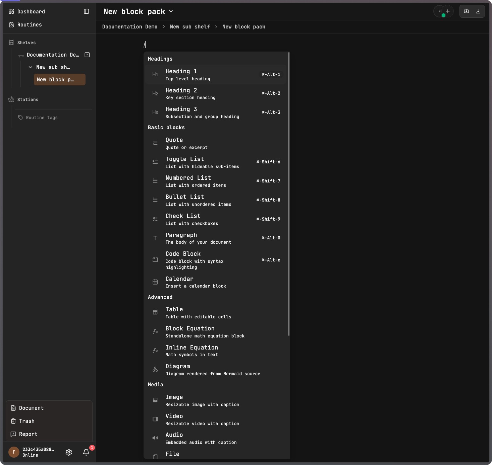

選單中看見的「清單」、「圖表」或「行事曆」，是文件裡的內容區塊，不是 Dashboard Widget，也不是自動化設定。例如在文件插入行事曆，不會因此建立 Routine 排程。

##### Headings and lists

標題用來分段，段落用來寫說明。你可以先用一個大標題標明主題，再用較小標題分出問題、資料與結論。標題層級是文件結構的一部分，不只是把字放大。

清單則依用途選擇：沒有固定順序的重點用項目清單；需要照順序做的事情用編號清單；希望勾選進度時用檢查清單。可收合的清單或標題適合放較長的補充，讓正文不必一次展開全部。

##### Tables and code

表格適合比較多筆資料，例如不同研究來源、觀點與待確認事項。先決定每欄要回答什麼問題，再填資料，比把每段長文都塞進格子更容易閱讀。

程式碼區塊適合保留需要精確格式的內容，例如程式片段或指令。程式碼寫在文件裡只是記錄，不會因為顯示出來就自動執行。如果要分享，先移除密鑰或私人資料。

##### Math and diagrams

公式可以獨立成一個區塊，也可以插在文字中間。獨立公式適合要單獨閱讀的式子，行內公式則適合解釋一句話中的符號。

Diagram 可以把 Mermaid 文字轉成圖。以下是插入後的簡單示例，只有開始和結束兩個節點：

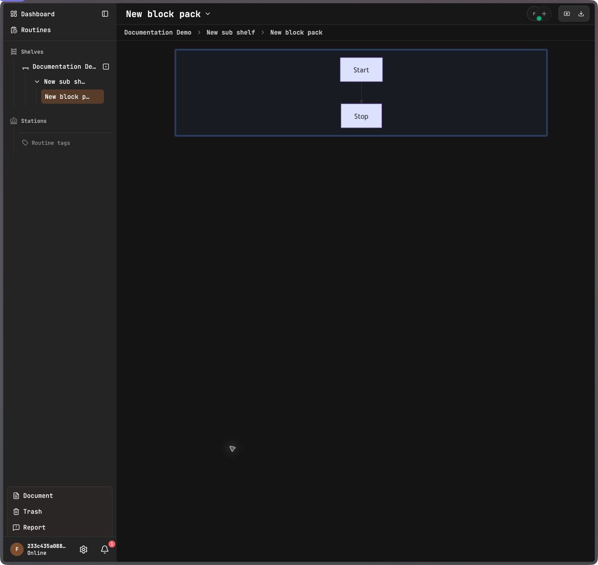

雙擊圖表可以開啟文字編輯區，修改後用畫面上的 OK 完成這次編輯。例如目前示例的來源如下：

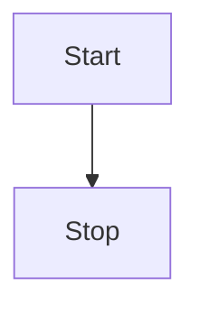

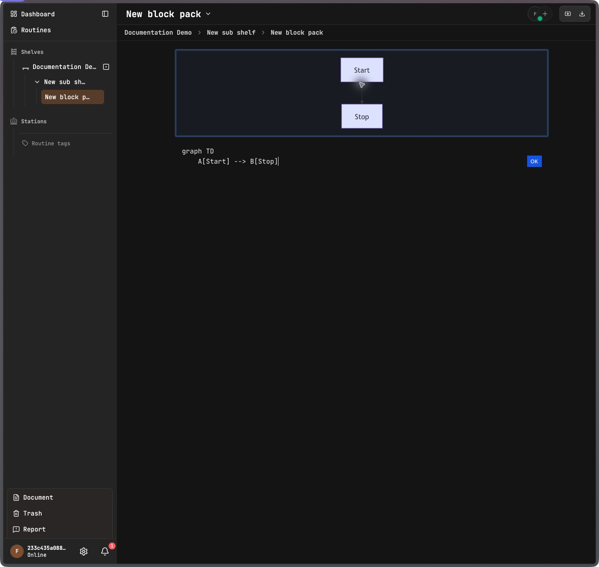

文件裡的箭頭用來表達內容，不會因此控制 Routine。若你要安排真正的任務先後順序，請使用後面介紹的相依關係編輯器；這兩種圖雖然都含節點與連線，用途不同。

##### Images and other media

插入選單也提供圖片、影片、音訊與檔案等內容。這些是文件中的媒體區塊；實際能使用的來源與操作，請依該區塊提供的欄位填寫。

在外部媒體載入不出來時，先確認來源仍可存取，以及目前帳號是否有權查看。不要把帶私人簽章或短期授權的下載網址，當成可以長期公開分享的素材來源。

##### Arrange your content

以研究摘要為例，可以先建立三個部分：

1. 用標題寫下研究主題。
2. 用段落整理目前理解與重要觀點。
3. 用清單記下待查證問題與下一步工作。

段落順序需要調整時，使用區塊旁的拖曳把手移動；只是要改文字就點進內容，不必拖曳。若操作把手看不到，也可以先檢查編輯器偏好是否調整過顯示方式。

字體大小與閱讀寬度是另一件事。你可以把畫面調成自己讀起來舒服的樣子，不必為了視窗太寬，就把文件內容拆成奇怪的短行。

`<placeholder>` 影片：撰寫與整理 Block Pack。展示新增標題、段落與清單，開啟插入選單，使用區塊操作重新排列內容，再示範調整個人閱讀寬度。

#### Sharing and collaborating

想讓別人一起處理文件，先確認文件在哪個 Root Shelf，再從成員或分享管理入口檢查對方能不能進來。文件上方的參與者按鈕可以查看協作相關資訊，但「看見某個人」和「授予他編輯權」不是同一個操作。

你可以傳送文件網址讓對方找到文件，但網址本身不會給他權限。如果對方打不開，先確認他登入的帳號，以及是不是已加入正確 Root Shelf；一直換個方式傳送同一個網址，不會解決權限問題。

共同編輯時，留意連線與同步提示。若畫面出現同步錯誤，先保留目前工作，再依提示處理，不要把反覆重新載入當成第一步。

#### Permission and access control

閱讀、編輯、管理成員與轉移擁有權，是不同程度的操作。有的人只需要看資料，有的人要一起修改文件；不必為了讓對方看一份筆記，就把所有管理操作都開給他。實際可選角色與操作，以分享介面為準。

文件能看卻不能輸入時，先查看是不是唯讀。唯讀不一定代表故障，也可能是你的角色只能閱讀。需要一起編輯時，請資源擁有者或有權管理的成員調整，不要用共用帳號或分享 API key 代替正常授權。

Root Shelf 與 Station 的權限分開處理。加入文件協作不等於取得自動化管理權，也不要透過分享帳號或 API key 來繞過權限限制。

`<placeholder>` 影片：在測試專案中展示兩個不同帳號的文件存取差異，說明僅傳送連結與具備權限的差別。錄製前先隱藏真實電子郵件、私人名稱及其他敏感資訊。

#### Editor topbar

文件上方可以找到名稱、參與者、匯入與匯出。只看圖示不確定用途時，先停留查看提示；匯入和匯出方向相反，不要因為圖示相似就直接選檔。

##### Import

匯入是把支援的檔案讀進目前文件，轉成可編輯的內容；不是把檔案當附件保存。可選格式包含 Markdown、純文字、HTML 和符合文件結構的 JSON。

第一次匯入可以照這個順序：

1. 先建立一份空白 Block Pack，不要直接拿重要筆記測試。
2. 開啟匯入選單，選擇支援的檔案。
3. 等待結果，再查看標題、清單、表格與段落順序。
4. 確認內容適合繼續編輯後，再補上自己的整理。

如果你只是要保留原檔供參考，應使用 Material，而不是期待匯入後仍保有原檔的所有排版與行為。

JSON 必須符合編輯器可接受的文件結構，不是任意 JSON 資料都能變成文件。檔案無法辨識時，請確認格式與內容，不要只修改副檔名來繞過檢查。

##### Export

匯出是把目前文件下載成另一種格式。可以依接下來要做的事選擇：

- 想要主要文字：選純文字，但不要預期保留完整排版。
- 要繼續在文字工具整理：可考慮 Markdown，並檢查特殊區塊轉換後的內容。
- 要提供閱讀用副本：可選 PDF，再檢查分頁和顯示結果。
- 要交給其他文件工具：依用途選 HTML、DOCX 或結構 JSON，並確認對方工具能否使用。

不是每種 Block 在每個格式都會完全一樣。下載後先打開看一次，特別檢查表格、公式、圖表與媒體，再寄給其他人或拿來封存。

匯出副本不等於完整備份整個工作空間，也不代表每種匯出格式都能重新匯入。

#### Editor item path

名稱下方的路徑會告訴你，文件放在哪個 Root Shelf 和 Sub Shelf。如果你有兩份都叫「研究摘要」的文件，看這一行就能分辨它屬於哪個專案。

路徑用來辨識位置與導覽，不是權限設定，也不是本機檔案的保存位置。調整分類後，請重新確認路徑是否符合預期。

#### Connection and saving feedback

無法輸入時，不要直接把所有情況都當成同一個錯誤：

- 還在載入：先等文件準備好，不要連續重新整理。
- 已開啟但唯讀：先檢查自己是否有編輯權限。
- 出現同步錯誤：先保留目前工作，確認連線，再依畫面提供的操作處理。

若介面要求重新同步，請先閱讀確認提示，並盡可能透過可用的匯出方式保留重要內容。不要在還有未確認變更時，直接清除網站資料或重設本機狀態。

### Material viewer

#### File holder introduction

點開 Material，就是查看那份參考檔案。網站會依類型顯示圖片、影音、PDF 或文字預覽；你可以一邊看原始資料，再到 Block Pack 寫摘要，不必把兩份內容混在一起。

檔名先出現、內容稍後才載入是可能的情況。檔案較大或連線較慢時，先看畫面是在載入、已顯示不支援，還是出現錯誤，再決定下一步，不必一看到空白就重新建立 Material。

#### Supported file types

目前預覽介面涵蓋以下類型。這份清單說明預覽能力，不是上傳限制或檔案大小規格：

| Preview | Supported types |
| --- | --- |
| 圖片 | PNG、JPG／JPEG、GIF、SVG、WebP |
| 影片 | MP4、WebM |
| 音訊 | MP3 |
| 文件 | PDF |
| 文字 | JSON、Markdown、純文字、HTML |

##### Read the preview

圖片與 PDF 適合直接查看內容；影片和音訊則使用畫面提供的播放控制。文字類型顯示的是檔案裡的文字，例如 JSON、HTML 或 Markdown 的原始內容，不是把它自動變成一份 Block Pack。

因此，看到 HTML 標籤或 Markdown 語法，不一定是顯示壞掉。若你要編輯一份整理後的文件，請使用 Block Pack；HTML 在文字預覽中也不會直接執行成網頁。

影音播放還取決於瀏覽器能否解碼檔案。即使副檔名相同，內容編碼或檔案狀況不同，也可能影響預覽。

##### When a preview does not load

先檢查三件事：這個類型是否在預覽清單內、網路是否正常，以及原檔本身能否開啟。相同副檔名的影片，也可能因使用不同編碼而有不同結果。

如果介面提供下載且權限允許，可以用適合的工具查看原檔。不要只改副檔名，期待網站就能解析不同內容；也不要因為沒有預覽，就直接刪除唯一的原始資料。

#### Viewer topbar

檢視器上方提供目前 Material 的資訊與可用操作。操作前先確認檔案名稱與類型，避免將同名但不同位置的參考資料混淆。

Material 的檔案操作與 Block Pack 的匯入功能不同。若你想把參考資料整理成筆記，請另開 Block Pack 撰寫摘要，而不是預期預覽器會自動完成轉換。

#### Viewer item path

透過路徑確認 Material 的所屬位置，並返回相關分類。研究資料與摘要放在相近的分類中，通常更容易往返閱讀。

`<placeholder>` 影片：從研究專案開啟 PDF 與圖片 Material，展示載入、預覽與項目路徑，再回到 Block Pack 記錄重點。最後說明文字預覽與可編輯文件的差別。

### Routine overviewer

這個頁面把時間軸、圖表、流程設定和執行紀錄放在一起。剛開始看起來會有很多區塊，不需要每一塊都先研究；先知道自己是在找「某項工作的設定」，還是「某次執行的結果」，就能選對表格。

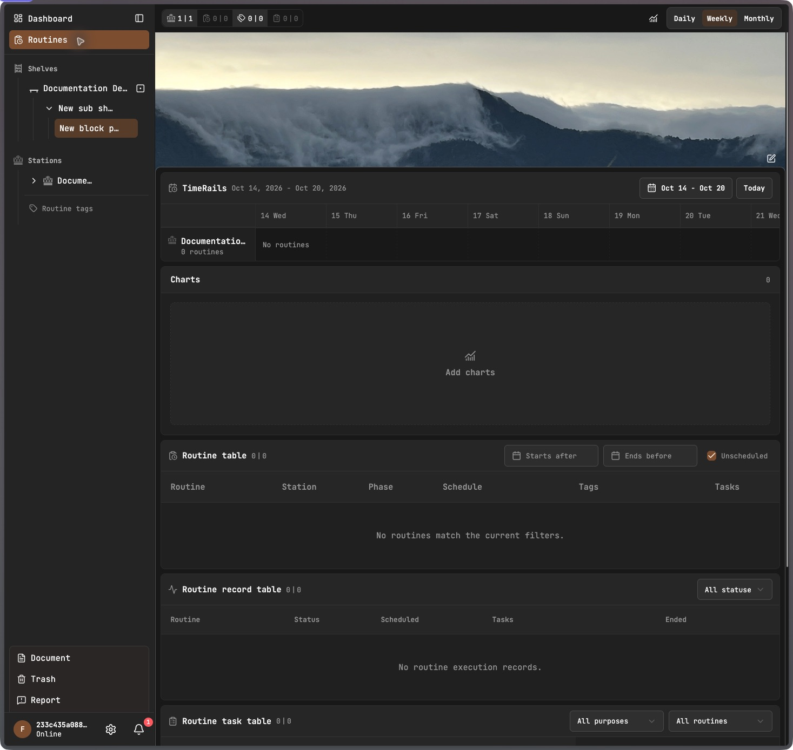

上圖使用剛建立的示例 Station，還沒有 Routine，所以會看到空列表。

#### Scope and filters

##### Choose what to show

頁面上方的數量與選擇入口，可以幫你確認目前顯示哪些 Stations、Routines 與標籤。需要縮小範圍時，開啟對應控制項，選取要看的項目，再完成套用。

例如，只想查看研究專案時，可以先保留對應 Station，避免和其他工作的資料混在一起。注意：調整後為顯示的 Station 並不代表已經被刪除。

##### Find a missing routine

先確認它所屬的 Station 有顯示，再看是否套用了標籤或時間篩選。沒有標籤的 Routine 也可能被篩掉，所以不要只勾選幾個標籤，就認為帳號中沒有其他工作。

表格本身還可能有自己的條件。上方已選對 Station，並不代表表格裡的時間或用途篩選也已清除；兩處都要確認。

#### Overview background image

背景只是工作頁面的外觀，不會因為換一張圖片就改變任務或執行時間。若你是從 Station 的表單設定背景網址，記得完成該表單儲存；這與 Dashboard 裡的本機背景選擇不是同一個入口。

不要將所有背景都視為 Dashboard 的本機設定；請以所操作的畫面與儲存提示為準。

#### Time rail

##### Change the visible time range

上方提供日、週、月等顯示尺度。想看近期細節時用較短範圍，想看工作分布則用較長範圍。日期範圍控制項可以切換要看的日期，Today 則讓你回到今天附近。

這些按鈕改的是時間軸現在顯示哪段時間，不是修改 Routine 的開始或結束時間。要改工作排程，請到該 Routine 的設定處理。

##### Read a scheduled item

找到排程後，先確認它對應的 Station、Routine 和日期，再比對設定中的時間與時區。時間軸上的位置讓你知道安排在哪裡，不代表工作已經完成。

需要確認成敗時，往下查看執行紀錄。如果同一項工作重複執行，請對照正確日期，避免拿另一次的結果解釋目前這一筆。

#### Charts

##### Add and choose a chart

第一次還沒有圖表時，可以按圖表區的 Add charts，或使用上方的新增圖表入口。選擇視窗目前依總覽、Routine、Routine Task 分組，提供不同問題的統計：

- 總數：查看相關資源的整體數量。
- 流程狀態：了解 Routines 在不同狀態的分布。
- 重複週期：查看流程使用哪些週期。
- 預定開始與結束時間：查看排程在時間上的分布。
- 任務用途：查看 Routine Tasks 用途的分布。

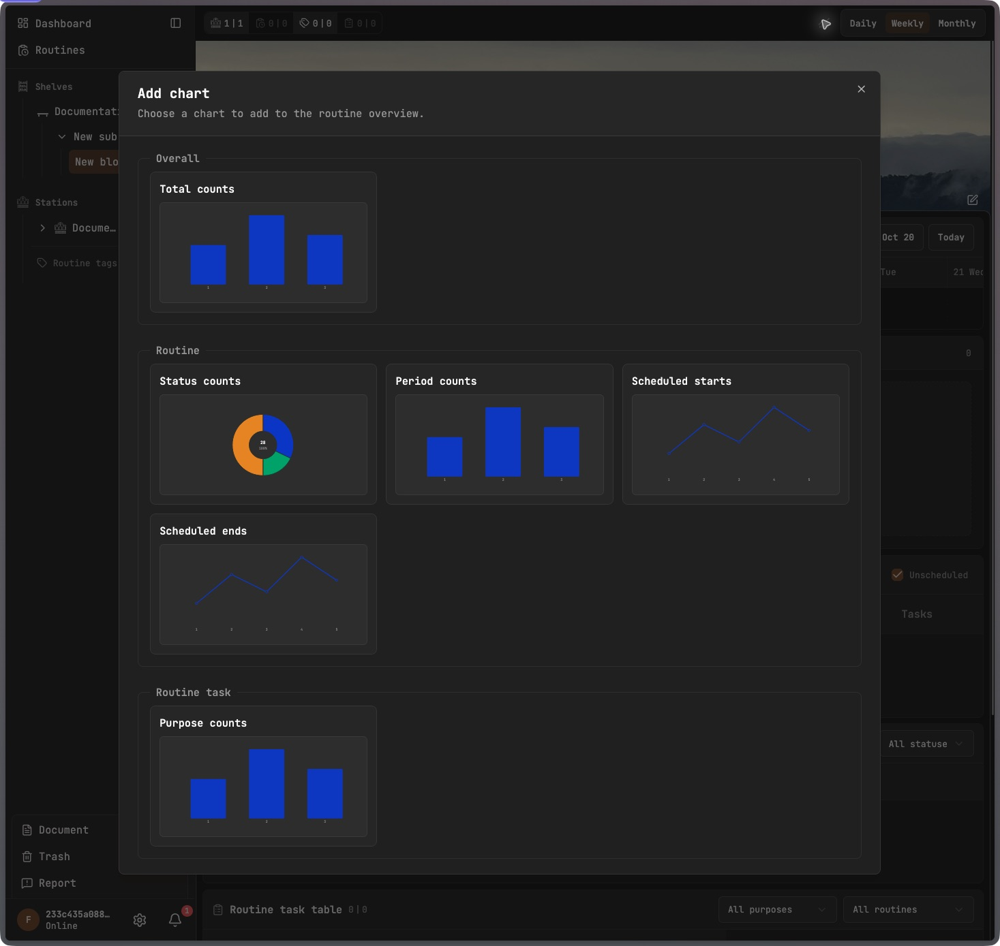

選擇視窗裡的圖是預覽，用來辨認樣式，不是帳號的實際統計。加入圖表之後，再看它讀取到的資料。

##### Read and manage charts

每張圖有自己的標題與可選指標。總覽圖與針對流程、任務的圖，統計對象可能不同；不要假設畫面上的每張圖都會跟著同一個篩選條件變化。先看圖名和時間範圍，再比較數字。

需要換個角度時，使用圖上的指標選單；不需要某張圖時，使用它的移除按鈕。移除圖表只是移除這個觀察畫面，不會刪除 Routine 或執行紀錄。

空白圖表可能表示沒有符合篩選的資料，也可能還在載入或遇到錯誤。遇到與預期不符的結果時，先查看列表與紀錄，避免只憑圖表下結論。

#### Routine table

這裡看的是流程設定。資料列會列出 Routine、Station、狀態、排程、標籤與任務資訊，適合先確認「工作放在哪裡、安排什麼時間、包含哪些步驟」。

表格上方可以依開始、結束時間等條件找工作，也要留意是否包含未排程的項目。若名稱找得到、換個時間條件卻消失，先檢查篩選，不必重新建立。

想改流程時，再從資料列的操作開啟詳細內容或 Inspector。這張表裡的設定不是最新一次執行的成績單；要查某次工作結果，改看下一張紀錄表。

#### Routine execution record table

這裡看的是 Routine 的每次執行。先找到對應流程和排程時間，再看狀態、任務數與結束資訊。可以用提供的狀態選擇縮小列表，再開啟要查的那一筆。

目前定義可能已在執行後修改，因此調查過去問題時，不要只依現在的設定推定當時情況。先保留相關紀錄資訊，再決定是否需要調整後續工作。

#### Routine task table

這裡列出任務本身的設定，例如名稱、Station、用途和所屬 Routine。可以用用途與流程條件找特定步驟，再從任務操作查看或修改。

如果兩個任務名稱很像，先看所屬流程與用途。要知道輸入了什麼資料，請開啟任務詳細內容或 Payload editor，不要只依名稱判斷操作會影響哪份文件。

#### Routine task record table

這裡看的是個別任務的執行嘗試。整個 Routine 結果不如預期時，可以再縮小到「哪個任務、哪次嘗試」出現問題。

依目前提供的狀態、排程時間或其他篩選找到紀錄，再看詳細資訊。找不到紀錄時，先區分沒有符合資料、仍在載入，以及讀取失敗，不要把它們都解讀成任務沒有執行。

執行紀錄不是可編輯的任務定義。若要修正之後的工作，應回到任務設定；若要回報問題，則保留足以辨識該次執行的時間與可見錯誤。

#### Create your first routine

第一次設定時，先用測試資料與單一任務。先把一個簡單步驟弄清楚，比同時加入排程、十個任務和許多依賴更容易知道哪裡需要調整。

##### Create a station

按側邊欄 Stations 旁的新增按鈕，輸入名稱。描述可以寫這裡要處理的工作；圖示和背景則用來辨認，不是必要的執行設定。

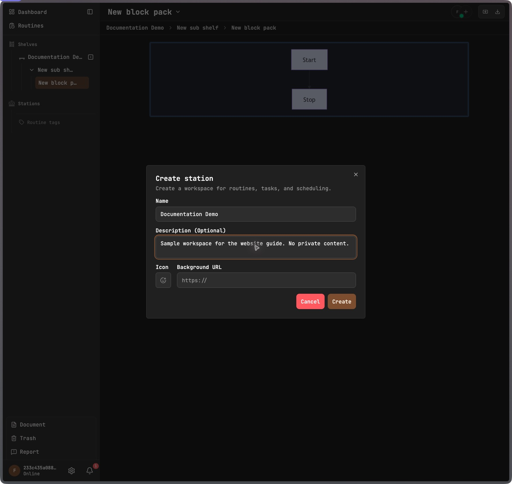

建立後，確認新 Station 已出現在側邊欄，再從它的選單新增 Routine。這樣比較不會把工作建立到另一個同名或相似專案。

##### Configure a routine

Routine 表單會要求名稱，並提供描述、執行逾時、排程、重複週期與釘選等選項：

- 名稱與描述：讓你之後知道這項工作在做什麼。
- 執行逾時：與工作允許執行多久有關，不是設定隔多久重複一次。
- 自訂排程：開啟後填寫開始和結束時間。不開啟時，表單仍會使用它提示的預設時間範圍，不能把留白當成暫停。
- 重複週期：決定是否重複，以及依介面選擇對應的日、週或月等安排。
- 釘選：方便辨認或使用，不是執行順序設定。

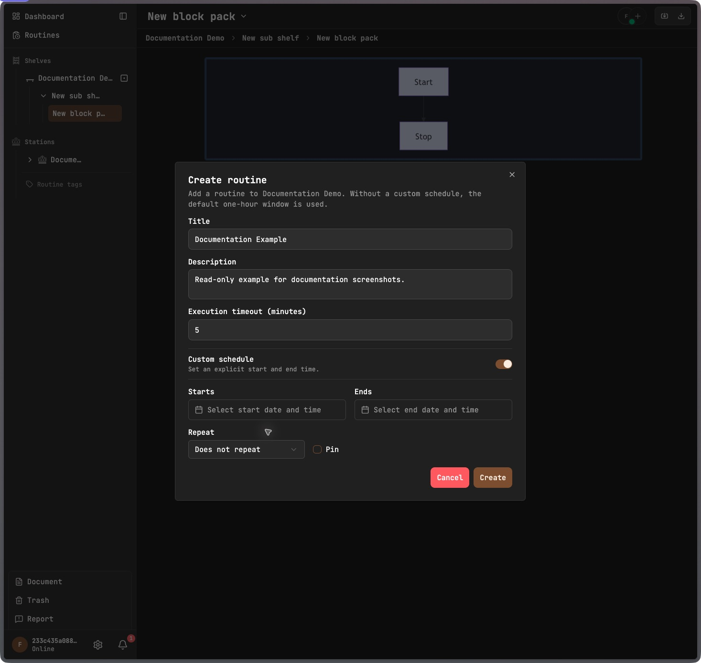

##### Choose dates and times

啟用自訂排程後，從開始和結束欄位開啟日期時間選擇器，選好日期，再檢查時與分。結束條件要符合目前週期的表單規則；出現驗證訊息時，先修正，再送出。

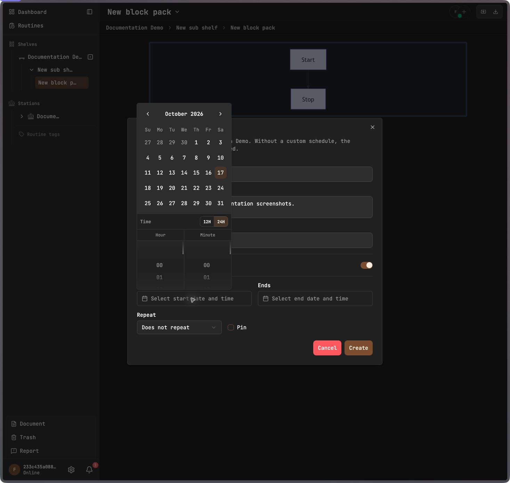

儲存後，也請在 Routine 詳細設定中確認時區。螢幕上顯示某個日期，不代表所有流程都採用你的直覺時區。第一次只是研究表單時，可以直接取消，不必先建立一個會執行的流程。

##### Add a task and check the result

準備好要建立時，可以依這個順序完成：

1. 在側邊欄建立或選取一個你有權管理的 Station。
2. 從該 Station 的操作建立 Routine，填寫能說明目的的名稱與描述。
3. 若需要排程，依介面設定週期與時間，並檢查相關時區。
4. 在 Routine 中新增一個任務，選擇用途並填入測試資源。
5. 確認輸入與儲存結果，再依介面提供的流程狀態與可用操作管理工作。
6. 需要檢查結果時，查看 Routine 與任務執行紀錄，不要只確認定義是否存在。

熟悉單一任務後，再加入第二個任務與相依關係。這樣比較容易辨識問題是來自輸入、排程，還是任務之間的順序。

`<placeholder>` 影片：建立測試 Station 與 Routine，加入一個使用測試資源的任務，檢查排程與輸入，再示範如何從流程定義切換到執行紀錄。只展示實際驗證成功的執行過程。

### Inspector

Inspector 就是把選取項目的詳細內容打開來看，不需要離開整個工作畫面。從 Station 或 Routine 的選單選擇 Open in inspector，就能查看對應設定；任務與標籤也有自己的詳細面板。

開啟後先看名稱，確認選對對象，再修改欄位。雖然面板長得像，但改 Station 的名稱、改 Routine 的排程，以及改任務輸入，做的是不同事情。

#### Station inspector

這裡可以查看與調整 Station 的名稱、描述、圖示或背景等資訊。名稱幫你找工作，描述則適合寫用途或團隊共識，不必把每個任務的細節全部塞在這裡。

Station 的外觀與識別資訊，不是 Routine 的排程設定。若目的是改變工作時間，請到對應 Routine 處理。

#### Routine inspector

這裡可以查看 Routine 的名稱、描述、狀態、排程、逾時與時區等設定。想改每週幾點執行，就要確認週期與對應時間；想改執行多久則看逾時，不要只因兩者都用時間表示就混在一起。

依表單提示完成儲存後，再檢查畫面呈現的結果。欄位出現驗證訊息時，先修正指出的內容，不要反覆提交相同設定。

#### Routine task inspector

這裡可以查看任務名稱、用途、輸入、優先權和嘗試次數等內容。要改實際處理哪個目標，請查看 Payload；要改步驟間的先後要求，則查看相依關係。

優先權、嘗試次數與前後依賴是不同設定。若某個步驟必須在另一個步驟之後進行，應檢查相依關係，而不是只靠名稱或列表順序表達。

#### Routine tag inspector

這裡可以調整標籤名稱、顏色與圖示。名稱適合寫用途，例如「研究整理」；顏色與圖示幫助辨認，但不會因此讓任務先執行或取得不同權限。

對於所有 Inspector，唯讀資訊只供確認，不需要手動修改識別碼來解決問題。若操作不可用，先檢查權限、連線與資料是否仍在載入。

### Routine task dependency graph editor

這裡的圖是工作設定，不是筆記裡的插圖。每個節點代表一個 Routine Task，連線代表哪一步要等哪一步。先確認目前 Routine，再開始編輯，避免把不同流程的步驟想成同一張圖。

#### Read the graph

例如，你想先準備資料，再處理結果，可以把順序想成：

```text
任務 A：準備資料 → 任務 B：處理資料 → 任務 C：整理結果
```

這裡表示 B 依賴 A，C 依賴 B；不是把節點放得越靠左就一定越早執行。真正要看的是連線方向，而不是它們在畫布上的位置。

#### Create a dependency

你可以依以下方式建立一個簡單順序：

1. 確認要連接的兩個任務都屬於目前的 Routine。
2. 決定哪個是前置任務，哪個必須依賴它。
3. 使用新增相依關係的操作或圖形連接控制項，建立從前置任務指向依賴任務的關係。
4. 檢查連線方向，以及畫面是否出現循環或其他驗證提示。
5. 查看儲存與同步狀態，確認變更已完成，而不只是出現在畫面上。

#### Check saving and sync

圖上已經畫出線，不一定表示已送到服務端。請一起看儲存狀態：正在保存、只有本機草稿、待同步和驗證失敗，需要的處理不同。

待同步時先確認連線，再使用介面提供的重試操作；驗證失敗則先修正關係，例如避免自己依賴自己或產生循環。尚有本機草稿時，不要先清除網站資料，否則可能丟掉還沒同步的內容。

重新載入、重試、重設和匯出也不是同一件事。匯出提供目前圖的資料副本，不是執行結果；重設不應被當成撤回所有已送出的操作。使用前先看目前狀態，避免為了調整節點位置而誤處理任務關係。

移除連線與刪除任務不同。前者改變執行順序的關係，後者會影響流程中的步驟；操作前請確認自己選取的是哪一個對象。

`<placeholder>` 影片：以兩個測試任務示範 A 指向 B 的依賴，展示選取節點、建立與移除連線，以及如何辨識草稿、儲存完成和驗證錯誤。不要用刪除重要內容的任務作為範例。

### Routine task payload editor

Payload 就是「這個任務要拿什麼資料來做事」。例如建立文件時要知道放在哪裡、名稱是什麼、內容是什麼；查詢資料時則要知道查哪個目標。先選好用途，再填輸入，不要先寫一份 JSON 才猜它適合哪個任務。

#### Use a form

部分建立與更新用途有專用表單，例如分類、Block Pack 與 Routine 的相關操作。表單可以幫你逐項選目標或填資料；若有範本編輯，則用來設定要產生的內容。

選取目標時，不只看名稱，也看它所在的專案。兩份同名文件可能完全不同；選錯後即使欄位都通過驗證，也不是你原本要處理的那份。

#### Use JSON

其他用途可能提供 JSON 編輯器。此時要依該用途要求的欄位填寫，不能把另一個任務的內容原封不動複製過來。JSON 語法正確只是第一步，目標是否存在、你有沒有權限和內容是否符合規則，仍要確認。

網站表單與公開 API 不一定提供完全相同的操作。需要程式整合規格時，再查看 API 文件，不要把網站裡所有可選用途都當成公開端點。

#### Confirm and save

建議依以下順序設定：

1. 先選定任務用途，再開啟輸入編輯器。
2. 選取或填入正確的目標資源。
3. 填寫必要內容，檢查預覽與驗證訊息。
4. 確認輸入編輯器中的內容，返回任務表單。
5. 完成任務表單的建立或儲存操作，再確認最終結果。

確認 Payload editor 不一定代表整個任務已儲存，請繼續完成外層任務表單。若改變用途，原本的輸入可能不再適用，需要重新檢查。

儲存後若還要確認輸入，可以重新開啟同一個任務，對照用途與目標。準備提供範例給其他人時，請另外使用測試資料，不要直接貼出包含密鑰或私人內容的 Payload。

`<placeholder>` 影片：展示一個有表單的任務用途，選取測試目標並填入內容，再確認輸入、返回任務表單並完成儲存。補充示範 JSON 語法錯誤時的提示與修正方式。

### Dialogs

建立資源、調整設定、編輯輸入與確認刪除時，通常會開啟對話框。每次操作先確認標題、目標名稱與影響範圍，再填寫欄位。

一般流程如下：

1. 從目前資源的對應操作開啟對話框。
2. 填寫必填欄位，並檢查格式與驗證提示。
3. 提交後等待結果，避免在處理中重複按下確認。
4. 回到原畫面確認新項目或變更結果。

取消或關閉對話框的效果，依該介面而不同。重要內容尚未確認時，請先查看是否有草稿或未儲存提示，不要一律假設關閉後都會保留。

刪除、離開共享範圍、轉移擁有權與重設帳號，都可能產生不同後果。請閱讀每次確認提示；要求輸入確認文字時，應先理解影響範圍，而不是把它當成可以略過的例行步驟。

---

## Settings

不確定設定要去哪裡找，可以先用這個分法：改個人資料、登入與密鑰，找帳號設定；改主題、顯示、編輯習慣與通知，找偏好設定。

從側邊欄底部的帳號或設定選單就能進入。欄位名稱會依介面語言不同而改變，但用途相同。部分偏好切換後立即套用；個人資料與其他表單則可能需要另外保存，請看目前區塊的按鈕。

### Account settings

#### Profile and account information

##### Personal profile

個人資料區可以編輯介面提供的頭像、封面、簡介與其他個人欄位。圖片選取後，先看裁切預覽；文字修改後，完成表單的保存，再確認畫面已更新。

不是每個欄位都一定要填。分享畫面或截圖前，也可以先看看有沒有不想公開的生日、地區或個人介紹。

##### Account identity

帳號資訊區會顯示可用來辨認帳號的資料，並提供顯示名稱、狀態等可編輯項目。顯示名稱用來讓人認出你，不等於登入用的電子郵件，也不是資源擁有權。

唯讀資訊通常是讓你確認或辨認帳號，不是要手動修改的設定。需要改登入電子郵件或密碼時，請到對應的帳號修改流程，不要只改顯示名稱就預期登入方式一起改變。

#### API keys

如果只透過網站操作 Notegic，不需要為此另外建立 API key。只有在外部程式或工具需要整合時，再到 [帳號設定的 API keys 區塊](/app/setting/account#api-keys) 管理密鑰。

##### Create a key

建立前先想清楚用途，再取一個能辨認的名稱，例如給哪個程式或哪個環境使用。密鑰顯示時，依提示複製到可信任的密鑰管理位置；不要先關掉畫面，再預期之後能重新查到完整密鑰。

不要把它放進前端程式碼、網址、公開筆記或截圖。這是一個讓程式以你的權限請求資料的憑證，不是可以交給協作者共用的文件連結。

##### Review and revoke

整理密鑰時，先確認名稱與用途，再撤銷不再使用的 Key。如果某個程式還在使用它，撤銷後就可能無法繼續請求；需要換 Key 時，先安排程式更新，不要只在網站把舊的刪掉。

若懷疑密鑰外洩，請停止分享，並依 [API key 說明](/document#quick-start) 處理。回報問題時可以描述用途與錯誤，不需要附上完整 Key。

#### Upgrade and quotas

這裡可以查看方案、用量與相關限制。建立資料時遇到數量限制，可以先看目前有哪些項目已使用，再決定是否整理不需要的內容，或了解其他方案。

儲存量、可建立的資料數量與任務執行用量，是不同的限制。不要把「還有空間」直接理解成所有操作都不受限制；實際原因應以當次提示與帳號顯示的資訊為準。

方案、權益與可用操作以帳號目前顯示及正式公告為準。若畫面尚未提供購買或升級操作，不要將方案比較直接理解為已完成訂購，也不要在不同地方重複提交。

#### Security

需要驗證電子郵件時，從安全區的對應操作開始，依畫面取得驗證碼，再輸入並確認。先看清楚這次驗證的是哪個帳號或地址，避免把不同流程的驗證碼混在一起。

驗證碼只應輸入在你主動開啟且可信任的驗證畫面。不要傳給其他人，也不要附在支援回報中。若發送按鈕顯示等待時間，請等候後再嘗試，不要連續要求寄送。

#### Linked sign-in and recovery methods

這裡整理登入連結與帳號相關的聯絡或備援資訊。介面提供備用電子郵件、電話或登入提供者的操作時，請分別閱讀對應說明，不要把新增聯絡資料和建立另一個帳號當成同一件事。

需要驗證碼的項目，填好資料後仍要完成驗證；看見輸入欄位不代表已經綁定成功。登入提供者的連結則可能帶你前往該服務確認，操作前先確認目前選取的身分。

變更登入方式前，請確認之後仍能登入同一帳號。不要假設調整連結就會自動轉移專案、合併兩個帳號，或撤銷所有既有存取。

#### Account modification

這裡放的是會明顯改變帳號的操作。每項都要分開看：

- 修改電子郵件：影響的是相關帳號資料或登入流程，不是只換顯示名稱。
- 修改密碼：請從可信任的頁面開始，並完成畫面要求的驗證。
- 重設帳號：可能影響資料與設定，先閱讀此次操作的範圍。
- 刪除帳號：先確認不再需要帳號與相關內容，再處理共享資料、重要文件與整合。

帳號重設與刪除不適合用來處理一般顯示或載入問題。執行前，先保存重要工作，並確認共享資源、協作者與外部整合是否可能受到影響；不要預期操作後一定能復原。

### Preference settings

你可以從 [偏好設定](/app/setting/preferences) 調整自己怎麼使用網站。這些主要是目前瀏覽器的選擇，不是替所有協作者一起改設定；換瀏覽器時，也不要預期每項偏好都已自動同步。

#### Appearance

這一區可以調整主題、介面語言、顯示密度與動態效果。先依你遇到的問題選擇，不必把所有項目都試一次：

- 顏色或對比不適合：先換主題。
- 想改按鈕與選單文字的語言：改介面語言；這不會自動翻譯你寫的文件。
- 想在畫面上放更多資料：嘗試較緊湊的密度；覺得太擠則選較寬鬆的密度。
- 不喜歡較多動畫：開啟減少動態效果。
- 想調整操作時的細微回饋：查看互動回饋選項；實際效果也受裝置支援影響。

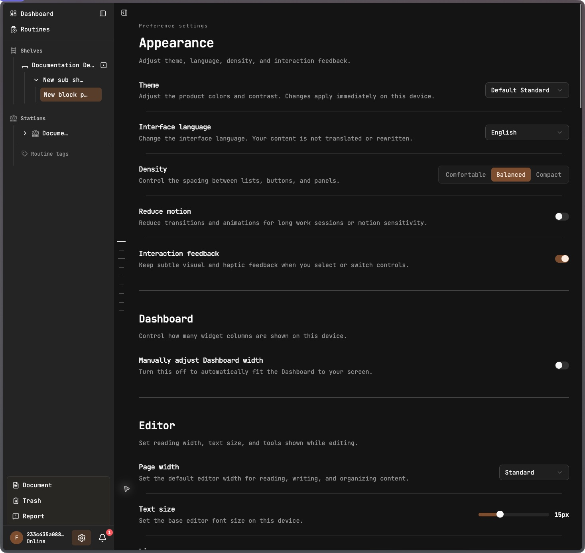

這些設定改變的是呈現方式，不會因此改變文件的存取權限或共享內容。

#### Dashboard

這裡可以選擇是否手動控制 Dashboard 的寬度。自動模式適合讓頁面配合目前螢幕；需要固定比較多或比較少的欄位時，再考慮手動調整。

這與移動某個 Widget 不同。想讓整個工作區更寬，看這個設定；想讓一個時鐘變大，回到 Dashboard 調整那個工具的尺寸。

重設 Dashboard 相關選項前，先確認是否會影響本機的版面或元件內容。不要將重設偏好與刪除帳號中的文件視為同一件事。

#### Editor

編輯器偏好把閱讀方式和操作工具放在一起。你可以先開一份測試文件，再逐項比較：

- 頁面寬度：選擇較窄、標準或較寬的閱讀範圍。長段落太難追行時，先試較窄寬度。
- 文字大小：調整目前裝置的編輯器文字，讓閱讀舒服，不必把每個段落改成標題。
- 自動換行：讓較長的行依可用寬度折行，而不是一直向右延伸。
- 拼字檢查：使用瀏覽器提供的檢查，結果受瀏覽器語言與設定影響。
- 區塊拖曳把手：決定是否顯示用來移動或管理 Block 的控制項。

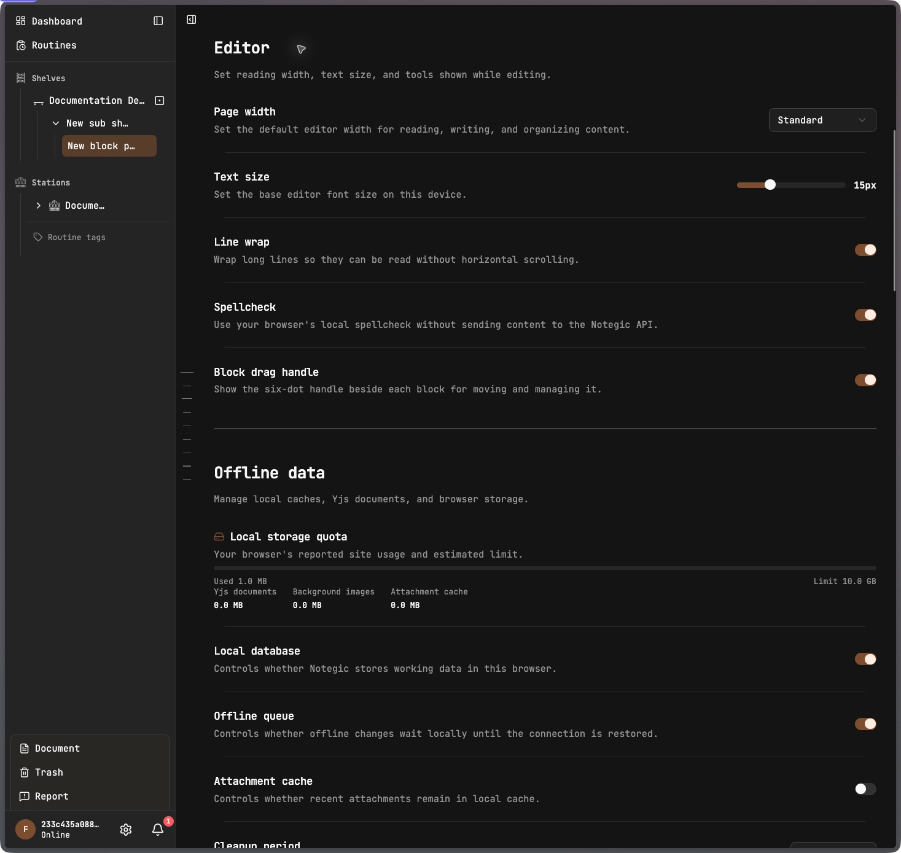

個人顯示偏好不是文件格式轉換。若要將內容交付為 PDF、Markdown 或其他格式，仍應使用文件的匯出操作。

#### Offline and local data

##### Understand local storage

這裡會顯示瀏覽器回報的網站儲存使用量，以及文件、背景與附件等快取資訊。它是這個瀏覽器保存的資料，不是整個帳號的雲端容量，也不是每個裝置都共用的同一份空間。

本機資料、離線佇列與附件快取分別控制不同事情：工作資料是否留在瀏覽器、離線變更是否等待重新連線，以及是否保留部分附件供之後載入。開啟其中一項，不代表所有功能都能離線完成。

##### Reconnect safely

離線後回到網站，先看有沒有待同步或錯誤提示。結果尚未確認時，不要立刻重複新增同一份資料，尤其是剛才已送出但沒有收到結果的操作。

分享、權限變更與某些管理操作需要服務端確認，不能因為筆記還看得到，就認為所有操作都能離線完成。

##### Clean up carefully

清理週期與快取操作會影響本機資料。執行前，先保存重要的 Dashboard 內容、檢查尚未同步的變更，再讀清楚要清掉的是哪一類資料。不要為了處理一個畫面載入問題，就一次清除所有網站資料。

如果支援人員請你提供診斷資料，也先確認其中是否有私人內容。下載出來的資料不是可以直接公開的附件，也不一定是能完整還原工作空間的備份。

#### Privacy

##### Start page and previews

起始頁面可以選擇 Dashboard 或 Routines，適合依主要工作習慣調整。隱藏預覽標題則是減少切換器與預覽中露出的筆記名稱，分享螢幕時可先確認是否符合需要。

這不是把整個網站變成無法辨識的隱私模式。正式錄影或分享前，仍要自己查看畫面，避免露出文件正文、成員或其他私人資訊。

##### Clipboard protection

剪貼簿防護提供可設定的比對規則，幫助處理介面支援範圍內的敏感文字情況。新增自訂規則時，先用測試文字確認結果；規則格式錯誤或已存在時，先依提示修正。

規則列表可以調整順序或移除不需要的項目。這類工具不能保證辨認所有機密，也不會改變帳號或文件權限；在貼進聊天、公開文件或回報前，仍要自己檢查一次。錄影與分享螢幕時，也要另外確認畫面上的內容，不要只依賴剪貼簿規則。

資料處理與使用條款請以 [隱私政策](/document#privacy-policy) 和 [EULA](/eula) 為準。

#### Browser permissions

這裡顯示瀏覽器對通知、剪貼簿讀寫、持久儲存與位置等列出能力的權限。列表是在說明瀏覽器狀態，不代表這些能力都已用於每一項功能。

允許、拒絕、等待詢問和無法查詢是不同結果。遇到不支援查詢時，不需要反覆按請求；先確認瀏覽器本身是否提供該能力。你也不需要為了閱讀筆記，把所有權限全部開啟。

只在需要對應功能時授予權限。若之前拒絕，可能需要到瀏覽器的網站設定調整，再回來更新狀態。瀏覽器權限與 Root Shelf、Station 的成員權限分開，不能互相取代。

允許瀏覽器保存資料也不能取代備份；清除網站資料或裝置遺失仍可能影響本機內容。

#### Feedback

表單提供問題、功能建議與其他回饋等類型。先選類型，再用一句話作為標題，詳細內容則寫原本想做什麼、怎麼操作，以及實際看到什麼。

送出期間等候結果即可，不要一直按相同按鈕。若送出失敗，先保留文字，再依提示處理。回報會附上目前頁面位置與基本瀏覽器環境資訊協助重現，不需要在正文補上所有內部診斷或帳號憑證。

附圖前先遮蔽私人名稱、內容、密鑰與驗證碼。不要為了提供完整資訊而直接附上整份私人文件或瀏覽器資料庫。

#### Notifications

你可以分別選擇介面提供的桌面通知、工作提醒與同步提示。想看通知但沒有收到時，先區分：是網站內的訊息、短暫提示，還是需要瀏覽器允許的桌面通知。

安靜模式可以設定開始與結束時間，適合不想一直被打斷的時段。調整後也要看清楚時間範圍，不要把它當成變更 Routine 的排程。

通知是提示，不是執行完成的保證。重要工作仍請回到通知列表或執行紀錄確認結果，不要只靠「沒有跳提醒」就判定沒有執行。

#### About

這裡可以查看介面顯示的版本資訊，也提供複製偏好與重設偏好的操作。

複製偏好是把設定資料放到剪貼簿，不是匯出所有筆記、附件與 Dashboard 內容。需要交給支援人員時，先確認內容再貼上。重設偏好則會改變個人選項，想保留目前習慣時先記錄，不要把它當成每次排查都要執行的步驟。

各版本的功能變更請以 [Versions](/document#versions) 為準，授權條款則查看 [EULA](/eula)。本指南不另外抄寫可能隨版本變動的完整方案與版本數值。

### Full-page and sheet presentation

設定頁面上的切換按鈕，可以在支援的螢幕尺寸下改用完整頁面或側邊面板。想一次讀完很多設定，用完整頁面較方便；只想在工作中改一個偏好，側邊面板比較不會打斷原本畫面。

切換呈現方式前，先完成目前表單的必要確認。不同設定可能立即套用，也可能需要按下儲存；不要將某一個區塊的行為套用到所有設定。

`<placeholder>` 影片：從帳號選單開啟設定，展示頁面與側邊面板切換，再調整主題、編輯器寬度與通知偏好。避免錄製真實 API key、驗證碼或任何帳號刪除流程。

---

## Contact & Support

### Find the right information

遇到問題時，可以先依目的選擇入口：

- 想了解網站操作：閱讀本指南的對應介面或設定章節。
- 想整合其他程式：查看 [API 文件](/document#gateway) 與 [API key 說明](/document#quick-start)。
- 想確認版本變更：查看 [Versions](/document#versions)。
- 想回報問題或提出建議：使用側邊欄的問題回報入口，或偏好設定中的回饋區。

### Before reporting a problem

回報前，可以先做不會破壞資料的基本確認：

1. 確認登入的帳號、選取的資源與目前篩選範圍。
2. 檢查連線、載入狀態與畫面上的錯誤提示。
3. 若與權限有關，請資源擁有者確認成員與角色。
4. 記下發生時間，以及問題出現前最後幾個操作。
5. 若仍有未儲存或未同步內容，先保留工作，再嘗試其他處理方式。

不要將清除網站資料、重設帳號或刪除資源當成第一步。這些操作可能移除本機內容，也可能讓問題更難確認。

### A useful problem report

回報不需要寫得像技術報告，先讓人能照著你的步驟重現即可。例如「開啟某份文件後不能輸入」比只寫「壞了」更容易判斷。你可以依下面的格式整理，知道多少就先填多少：

```text
發生問題的畫面或功能：
原本想完成的操作：
預期結果：
實際結果：
重現步驟：
瀏覽器與作業系統：
發生時間與時區：
畫面上的錯誤訊息：
已遮蔽敏感資訊的截圖或錄影（如有）：
```

只提供排查所需的資訊。文件網址、資源識別碼或檔案內容，只有在必要且支援管道可信任時才提供；不要附上 API key、密碼、驗證碼、工作階段資訊或帶簽章的私人下載連結。

### Common situations

- 找不到文件：先確認 Root Shelf、收合的分類與帳號權限，再查看適用的垃圾桶列表，不要立即建立重複副本。
- 編輯器無法輸入：先確認是否唯讀、仍在載入，或出現同步錯誤。
- Material 無法預覽：確認檔案類型、連線與載入結果；可下載時，再以適當工具確認原檔。
- 自動化結果不符預期：查看正確 Routine 與任務的執行紀錄，並確認時間範圍與相關輸入。
- 換瀏覽器後版面不同：先區分瀏覽器本機的自訂內容與帳號中的共享文件，不要把所有設定都當成會同步。
- 操作結果不明：先檢查列表與狀態，再決定是否重試；尤其不要反覆提交新增、刪除或其他可能改變資料的操作。

如果以上確認仍無法解決，請將可重現的步驟與已遮蔽敏感資訊的畫面一併回報。回報時不需要公開你的完整工作空間。
